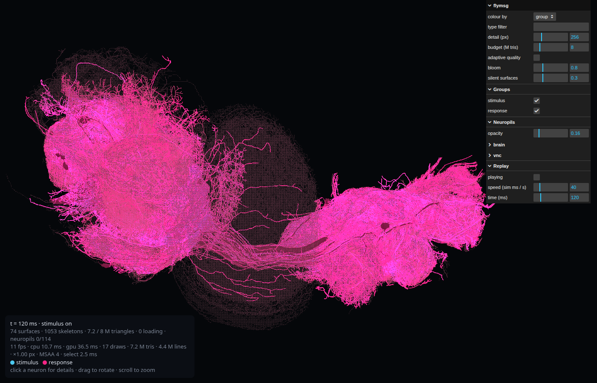
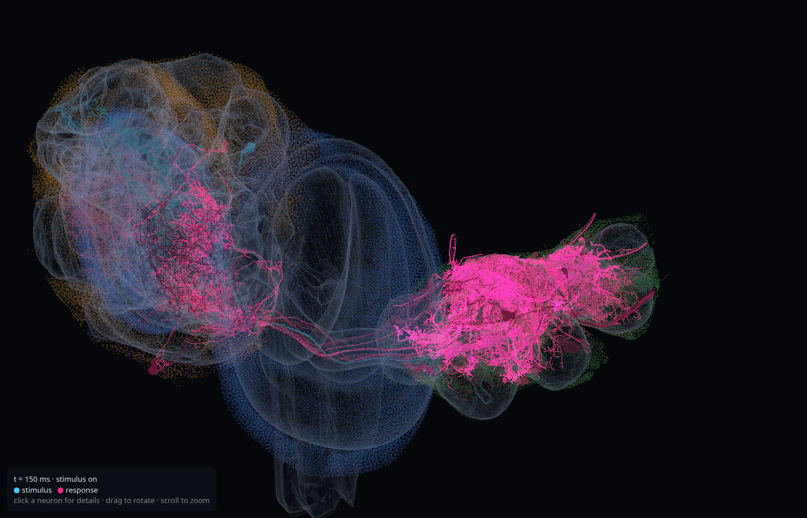
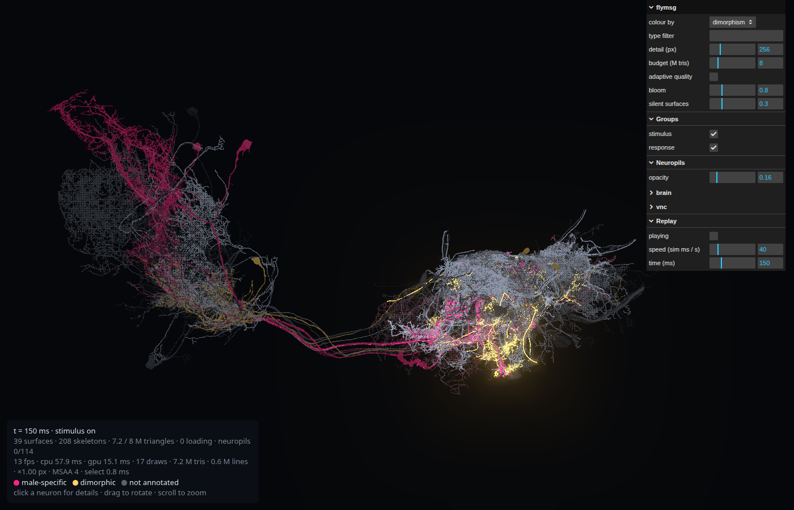
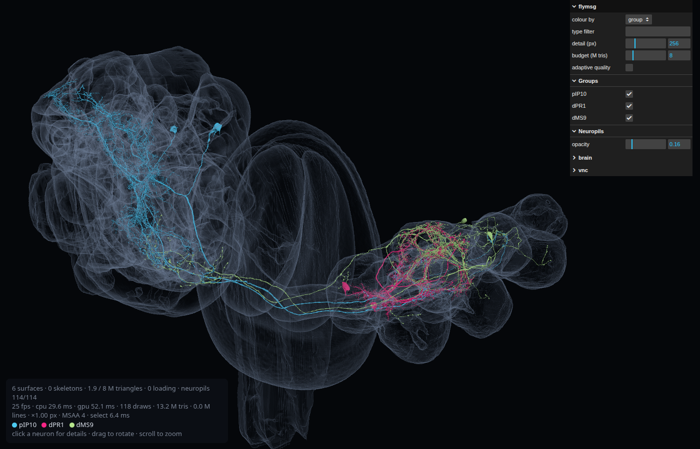
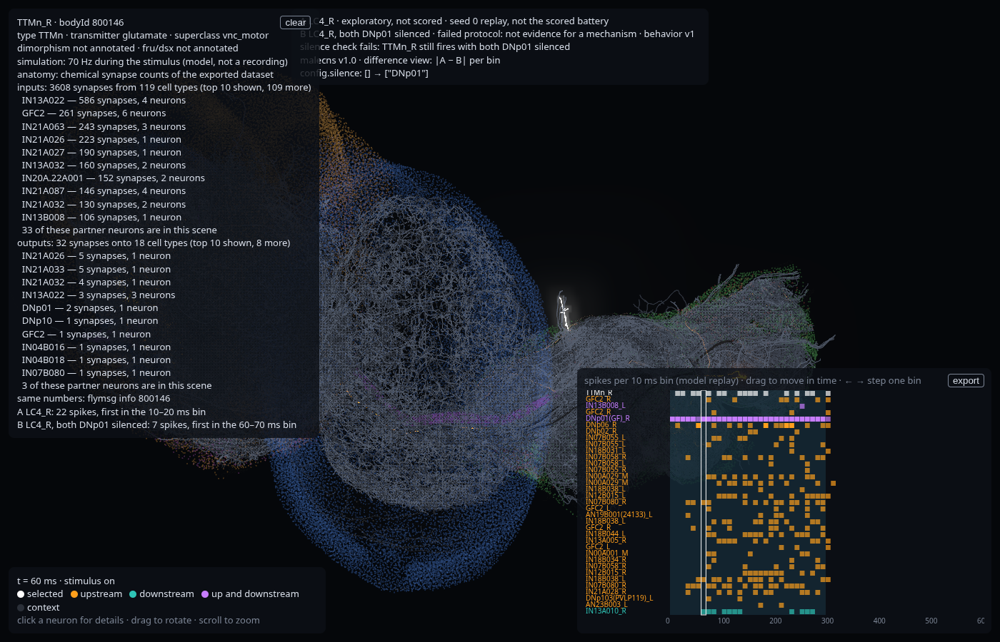

# flymsg

[](https://github.com/gianlucamazza/flymsg/actions/workflows/tests.yml)
[](LICENSE)

Simulate and view in 3D the first complete central nervous system of a male fruit fly:
[MaleCNS v1.0](https://male-cns.janelia.org/) (Janelia FlyEM + Google, CC-BY 4.0), with
165,122 traced neurons, 25.6 M connections and 124 M synapses across the brain, optic lobes
and ventral nerve cord.

flymsg turns the wiring diagram into a spiking network, checks the simulation against
circuits whose function is known from experiments, and streams the real neuron shapes into a
browser to replay the activity.

The same pages are published at <https://gianlucamazza.github.io/flymsg/>.

## Gallery

Paused frames from the page `flymsg viz` writes, 1400×900, adaptive quality off, with the
geometry loaded. Shot with `scripts/shoot.mjs` on desktop OpenGL (`GL=gl`). `?chrome=0`
does not build the control panel and hides the performance readout; the colour legend
stays. A replay
colours neurons by group unless a frame says otherwise, keeps silent neurons desaturated,
and draws the neuropil shells around the somata in `docs/live/cns/`. An anatomy view draws
the shells and does not replay spikes. Rebuild the scenes with `flymsg viz --sim LC4_R`,
`--sim pIP10` and `--types pIP10 dPR1 dMS9`. The page takes `?t=`, `?paused`, `?color=`,
`?chrome=`, `?neuropils=`, `?somata=` and `?select=<bodyId>`; clicking a neuron lists its
partners. Rendering is described in [viz](docs/viz.md).

Each scene also runs live in the browser on the published site: the page streams the
neuron surfaces from the public MaleCNS volumes, and the scenes are the committed exports
in `docs/live/` (rebuild them with `scripts/build_live_scenes.py`). Around every scene the
site draws all 140,024 somata of the volume as faint points coloured by region, so the whole
CNS is visible. A desktop GPU helps.



**Looming, LC4_R, 120 ms, stimulus on.** The pulse lasts 300 ms. The stimulus is the 55
LC4_R neurons. The response fills the brain and the ventral nerve cord.
[Open live](https://gianlucamazza.github.io/flymsg/live/looming/?t=120&paused&neuropils=1).



**Song pathway, pIP10, 150 ms, stimulus on.** Both pIP10 neurons are the cyan stimulus.
Recruited neurons are magenta. [Open live](https://gianlucamazza.github.io/flymsg/live/song/?t=150&paused&neuropils=1).



**Same replay, coloured by the sex annotation.** "Potentially …" calls join their class.
Magenta is male-specific, and both pIP10 neurons are in it. Yellow is dimorphic, and both
dMS9 neurons are in it. Grey has no dimorphism label; both dPR1 neurons are there, and they
carry `fru+dsx` on the other field. Enrichment for the whole cases is in
[dimorphism](docs/dimorphism.md). [Open live](https://gianlucamazza.github.io/flymsg/live/song/?t=150&paused&color=dimorphism&neuropils=1).



**Anatomy, no replay.** One colour per type for the six neurons, drawn inside all 114
neuropil shells. pIP10 is male-specific, dMS9 is sexually dimorphic, and dPR1 is `fru+dsx`
with no dimorphism label. [Open live](https://gianlucamazza.github.io/flymsg/live/anatomy/).



**Intervention, LC4_R with both DNp01 silenced.** The failed silence check, against the
intact replay: `TTMn_R` still fires. [Open the comparison](https://gianlucamazza.github.io/flymsg/live/looming-vs-dnp01/?run=difference&t=60&paused&select=800146).

**Residual partner, DNp02 or DNp06 silenced as well.** With DNp01 already silenced, `TTMn_R`
goes from 7 spikes to 0 ([DNp02](https://gianlucamazza.github.io/flymsg/live/dnp01-vs-dnp02/?run=difference&t=60&paused&select=800146),
[DNp06](https://gianlucamazza.github.io/flymsg/live/dnp01-vs-dnp06/?run=difference&t=60&paused&select=800146)). The pre-registered
scan named both ([v2](docs/img/silence-scan-v2.svg)) and a replication on fresh seeds named
them again ([v3](docs/img/silence-scan-v3.svg)).

**An edge through the eye.** An ON edge moves front to back across the right eye under the
locked T4/T5 v4 protocol at its strongest lamina gain (configuration 11). Photoreceptors,
L1–L3 and the graded medulla glow by their potential, violet where they hyperpolarize, so the
lamina's inversion of contrast is visible; spiking neurons of the T4/T5 pathway glow by spikes.
A replay of one configuration, not the verdict, which is the locked run's
([eye](docs/eye.md)). [Open live](https://gianlucamazza.github.io/flymsg/live/eye-on/?t=600&paused).

**Left eye and both eyes.** The same looming drive from the left (`LC4_L`) or from both
sides. MaleCNS is one animal, not a symmetric template: `TTMn_L` fires about half as often as
`TTMn_R`. [Right against left](https://gianlucamazza.github.io/flymsg/live/right-vs-left/?run=difference&t=60&paused&select=804642),
[both eyes](https://gianlucamazza.github.io/flymsg/live/looming-bilateral/).

## What it does

- **Explore the wiring**: annotations and partners of any cell type (`info`); the strongest
  chain between two cell types, plus alternative routes (`path`).
- **Simulate**: a whole-CNS leaky integrate-and-fire model after Shiu et al.
  (_Nature_ 2024) (`sim`). On the same connectome the engine reproduces their published
  brian2 model within noise.
- **Validate**: a battery of known circuits with controls, dose-response and latency-order
  checks (`validate`). Model choices go through pre-registered rules (`calibrate`,
  `select-model`).
- **Check the wiring**: one shuffle of who connects to whom, each neuron keeping its degree
  and its outgoing weights (`wiring-null`); four pre-registered null families with many
  seeded draws (`nulls`). Every run that writes outputs also writes a
  [manifest](docs/nulls.md) (commit, dataset hashes, config, seeds, packages, platform).
- **Ask questions about sex differences**: how much simulated responses run through
  dimorphic neurons, and what silencing them does (`dimorphism`); the same model on the
  female FlyWire brain (`--dataset fafb`).
- **Test causal claims**: silencing scans and follow-ups locked before they run, each with a
  matched null and a stated failure rule (`silence-scan`, `partner-followup`), and one
  measured plasticity rule (`mb-plasticity`).
- **See it**: a three.js page streams source-resolution neuron surfaces, skeletons and
  neuropils from the public data, and replays the simulated activity (`viz`). The frames are
  in the gallery.

## Results so far

The index lives on the [roadmap](docs/roadmap.md#results). Each row is a verdict already
recorded on the linked page. Negative results stay in the
[findings log](docs/validation.md#findings-log).

| Result                                     | Verdict                                                      | Record                                                                                                 |
| ------------------------------------------ | ------------------------------------------------------------ | ------------------------------------------------------------------------------------------------------ |
| Validation battery, criterion v4           | 29/29 at `w_syn` 0.192, replicated                           | [validation](docs/validation.md)                                                                       |
| N1, one degree-preserving shuffle          | 5/29, all of them `stability`                                | [related](docs/related.md#n1-specific-checks-need-the-measured-partners)                               |
| Four null families, 20 draws               | the one-hop headline sits above every draw                   | [nulls](docs/nulls.md)                                                                                 |
| Engine against Shiu et al. brian2          | agrees within noise (r ≥ 0.998)                              | [comparison](docs/comparison.md#engine-check)                                                          |
| Dimorphism T1–T4                           | courtship runs through fru/dsx; escape and feeding do not    | [dimorphism](docs/dimorphism.md)                                                                       |
| Held-out ORN_DM1 → DM1_lPN                 | fails specific and stability                                 | [benchmarks](docs/benchmarks.md)                                                                       |
| Kenyon cell sparseness v1–v5               | dense or silent, never sparse                                | [model](docs/model.md#kenyon-cell-sparseness-diagnostic-2026-10-13)                                    |
| Kenyon cell sparseness v7                  | within only with the variant eLN set (lLN2T+lLN1_bc)         | [model](docs/model.md#kenyon-cell-sparseness-diagnostic-2026-10-13)                                    |
| Kenyon cell sparseness v8                  | v7 replicates under the exact continuous clamp               | [model](docs/model.md#kenyon-cell-sparseness-diagnostic-2026-10-13)                                    |
| KC → MBON11 depression v1                  | inconsistent: both odors go silent                           | [model](docs/model.md#dopamine-gated-depression-at-kenyon-cell-to-mbon11-synapses-optional-2026-10-13) |
| Synapse weight rule v1                     | undecided: density and count rank Liu et al.'s uEPSPs alike  | [model](docs/model.md#synapse-weight-scaled-for-synapse-density)                                       |
| Timestep convergence v1 (SF2)              | converged at 0.1 ms                                          | [validation](docs/validation.md#timestep-convergence-sf2-a-check-not-a-score)                          |
| Pulse vs sine song v1 (#36, held out)      | locked, not run                                              | [benchmarks](docs/benchmarks.md#pulse-vs-sine-song-across-neuropils-lock-2026-10-14-36)                |
| Looming → giant fiber timing v1 (#34)      | locked, not run                                              | [benchmarks](docs/benchmarks.md#looming--giant-fiber-timing-lock-2026-10-15-34)                        |
| One-bit looming jump                       | silence fails                                                | [behavior](docs/behavior.md#result-2026-10-11)                                                         |
| Residual partner scan v2, replicated as v3 | DNp02 and DNp06                                              | [behavior](docs/behavior.md#residual-partner-scan)                                                     |
| Partner follow-up v1                       | the left mirror replicates; DNp06 alone reaches the jump bit | [behavior](docs/behavior.md#residual-partner-follow-up)                                                |
| T4/T5 through the eye v1                   | neither                                                      | [eye](docs/eye.md)                                                                                     |
| T4/T5 v2 and v3                            | robust: neither                                              | [eye](docs/eye.md)                                                                                     |
| NeuroMechFly jump v1                       | short                                                        | [embodiment](docs/embodiment.md)                                                                       |
| Male vs female synapse counts              | median 1.81× over matched types, a reconstruction difference | [comparison](docs/comparison.md)                                                                       |
| Published sugar set, FAFB LB3 split        | 14 sugar-like and 6 LB3d-like neurons                        | [comparison](docs/comparison.md)                                                                       |
| Motor map                                  | every row `unmapped`                                         | `validation/motor_map.yaml`                                                                            |
| Held-out behavior milestone                | no eligible case left in the frozen partition                | [validation](docs/validation.md)                                                                       |

## Quick start

Requires [uv](https://docs.astral.sh/uv/) (Python 3.13) and, for the browser tests, Node ≥ 22 (CI: Node 24).

```bash
git clone https://github.com/gianlucamazza/flymsg && cd flymsg
uv sync
uv run flymsg fetch     # ~1.1 GB of public Feather tables into data/raw/, no account needed
uv run flymsg build     # compact to data/*.parquet (~10 s)

uv run flymsg path LC4 TTMn --alt 3
uv run flymsg sim LC4_R --duration 600 --stim-ms 300 --seeds 3 --superclass descending_neuron vnc_motor
uv run flymsg viz --sim LC4_R && python -m http.server -d runs/viz 8000   # open http://localhost:8000
```

Neurons are addressed by cell type (`LC4`), instance (`LC4_R`) or bodyId (`10001`). The data
directory defaults to `./data` (`--data DIR` or `FLYMSG_DATA` to change it).

Scientific outputs use execution-bound directories and automatic resume; the CLI prints
the final path. A clean committed worktree is required. See
[run integrity](docs/run-integrity.md) for output paths, checkpoints and historical locks.

## Commands

| Command                                                          | What it does                                                                                                                       |
| ---------------------------------------------------------------- | ---------------------------------------------------------------------------------------------------------------------------------- |
| `compare [--sex \| --fingerprint TYPE… \| --lb3-split]`          | male vs female: synapse density, the same model on both, the FAFB LB3 split                                                        |
| `fetch`, `build`                                                 | download and compact the connectome (`--dataset fafb` for the female brain, ~135 MB)                                               |
| `info TYPE`                                                      | annotations, top partner types, Neuroglancer link                                                                                  |
| `path SRC DST [--alt K]`                                         | strongest chain by input fraction; `--alt` adds routes avoiding the previous intermediate types                                    |
| `sim STIM…`                                                      | simulate a Poisson stimulus; per-type rates, reliability across seeds, latency, self-sustained activity                            |
| `validate`                                                       | the validation battery (a few minutes)                                                                                             |
| `behavior`                                                       | print the frozen one-bit looming-jump protocol, or run the closed loop with `--run`                                                |
| `wiring-null [--stats]`                                          | N1: shuffle who connects to whom; `--stats` counts self-loops and stops                                                            |
| `nulls [--full]`                                                 | four wiring-null families; default 2 draws (CI); `--full` is the locked 20-draw run                                                |
| `calibrate`, `select-model`                                      | parameter grid search and pre-registered model comparison                                                                          |
| `audit`                                                          | reconstruction completeness: flags bilateral neurons with one side far below the other                                             |
| `dimorphism [--silencing \| --loop \| --by-type CASE CATEGORY]`  | dimorphic neurons among responders; silencing by category, by cell type, or of the predicted dMS9 loop                             |
| `viz --sim STIM \| --path SRC DST \| --types … \| --eye POL DIR` | export a 3D scene; `--eye` replays one locked T4/T5 edge with graded potentials; the page streams geometry from the public volumes |
| `trace STIM --neurons N…`                                        | record v, g, threshold, spikes and input of chosen neurons; model states, not recordings                                           |
| `viz-compare A B --labels … --status …`                          | pair two replay exports; refuses mismatched datasets or time bases; no simulation                                                  |
| `sensitivity [--run]`                                            | the locked w_syn × th_jump grid around the defaults: every cell, spreads, a figure; a report                                       |
| `convergence [--run]`                                            | the locked timestep convergence check (SF2): the battery's responses at 0.1, 0.05 and 0.025 ms                                     |
| `song [--run]`                                                   | the locked pulse/sine benchmark against Pacheco et al. 2021 (#36): model and no-go first, then the data                            |
| `gf-looming [--run]`                                             | the locked looming → giant fiber timing benchmark against Dombrovski et al. 2025 (#34): model and no-go first, then the data       |
| `benchmarks [--run \| --corners]`                                | the frozen held-out manifest, scored with `--run`                                                                                  |
| `silence-scan [--run]`                                           | the locked residual `TTMn_R` partner scan (#20); prints the protocol without `--run`                                               |
| `partner-followup [--run]`                                       | the locked left mirror and direct drive of DNp02 + DNp06 (#76)                                                                     |
| `mb-plasticity [--run]`                                          | the locked dopamine-gated KC → MBON11 depression (#85), applied between trials                                                     |
| `weight-rule [--areas] [--run]`                                  | the locked count-vs-density comparison on Liu et al. 2022's PN → LHN uEPSPs (#139)                                                 |
| `kc-sparseness [--run]`                                          | the locked Kenyon-cell sparseness diagnostic (#95), v1–v8: recurrence, antennal lobe, odors, coupling                              |
| `jump3d [--run]`                                                 | the locked TTM-driven jump: TTMn spikes → measured twitch → NeuroMechFly in MuJoCo (#90, #94)                                      |
| `t4t5 [--run]`                                                   | the locked T4/T5 test: ON/OFF edges moving through the measured eye; polarity and direction (#84, #140)                            |
| `odor NAME`                                                      | a DoOR odorant as a response per MaleCNS ORN type (fetched, CC BY-SA)                                                              |
| `muscles`                                                        | MANC's muscle per MaleCNS motor neuron (Cheong 2024, fetched, CC BY); never an actuator                                            |
| `eye`                                                            | optic-lobe column → viewing direction (Zhao 2025 eye map, fetched) and photoreceptor → column                                      |
| `experiment FILE [--check]` · `runs`                             | run an exploratory config into an immutable directory; index every run manifest with its label                                     |
| `explore SRC DST` · `confirm LOCK`                               | paths and exploratory silencing; run a registered intervention lock against a matched null                                         |
| `jump --sim STIM --gain-n G --mass-kg M`                         | M1: a one-DOF jump body driven by a motor neuron through an engineered decoder (not a motor map)                                   |
| `loop --sim STIM …`                                              | M2: looming closed loop with disconnected, shuffled and replay controls; engineered parameters                                     |
| `homology`                                                       | versioned male/female type mapping (flywireType) and the LC4 → DNp01 pilot                                                         |

The 3D page takes URL options such as `?t=<ms>&paused`, `?color=dimorphism`, `?detail=`,
`?adaptive=0`,
`?neuropils=0|1`, `?somata=0` (hide the whole-CNS soma layer), `?budget=<M triangles>`,
`?bench=<s>` and `?xr=1` (experimental WebXR observer) ([viz](docs/viz.md)).

## How it works

1. **Data.** The MaleCNS tables list every traced neuron with its annotations (cell type,
   predicted transmitter, sex-related labels) and every connection with its synapse count.
   flymsg keeps the 165,122 traced neurons and the connections among them
   ([data](docs/data.md)).
2. **Model.** Each neuron is a leaky integrate-and-fire unit. A connection of _n_ synapses
   adds ±*n* · `w_syn` to its target after 1.8 ms. The sign follows the presynaptic
   transmitter: acetylcholine excites; GABA, glutamate and histamine inhibit; modulators have
   no fast effect. Stimulated neurons receive Poisson input spikes. All parameters are Shiu
   et al.'s, except `w_syn`, which is divided by 1.43, the lower quartile of the MaleCNS/FAFB
   synapse-density ratio (median 1.81; [model](docs/model.md)).
3. **Validation.** Each case stimulates a population and checks the expected target:
   - it fires reliably;
   - it fires far more than when the same number of random, similar neurons is stimulated;
   - it responds more to stronger input;
   - successive stages fire in order;
   - activity dies out after the stimulus.
4. **Rules before results.** Criteria, calibrations, model selections and every confirmatory
   experiment are written down in [validation](docs/validation.md) and a versioned, hashed
   lock in `validation/*.yaml` before they run; the runner refuses a lock edited without a new
   version, and a failure is recorded rather than tuned away. Every new lock names the records
   in `validation/evidence.yaml` that hold the source, units and uncertainty of its parameters.
5. **3D view.** The export holds only metadata and activity. The page reads the public
   multi-resolution meshes and skeletons directly from Google Cloud Storage, refining detail
   near the camera within a triangle budget ([viz](docs/viz.md)).

## Limits

- **One animal per dataset.** There is no measure of individual variability, and sex
  differences cannot be separated from reconstruction differences. `flymsg audit` flags
  incompletely reconstructed bilateral neurons (3.2 % of types, including MN9_R).
- **Wiring only, by default.** The default model has no gap junctions, no graded release and
  no neuromodulation. `sim.Gap` and `sim.Graded` exist and stay off unless a lock names
  them. A spike crosses a junction only when that lock sets `spike_mv` and `spike_ms`
  ([model](docs/model.md#electrical-synapses-optional-2026-10-13)). One optional plasticity
  rule (KC → MBON11) changes nothing unless called. Transmitters are machine predictions,
  and 2.6% of synapses carry no sign. What of the brain is in the model is counted in
  [roadmap](docs/roadmap.md#brain-coverage). The Giant Fiber behaves like a `shak-B²` mutant
  lacking its electrical synapse.
- **Qualitative rates.** Use the model to rank which circuits a stimulus recruits and in what
  order, not to predict exact firing.
- **Few, short cases.** The validation cases are mostly 1–2-hop feed-forward chains.

## Documentation

A fact has one home. The [roadmap](docs/roadmap.md#results) is the index of verdicts. A
protocol stays in its own page and in `validation/*.yaml`. A negative result is one line in
the [findings log](docs/validation.md#findings-log). A public source enters
[provenance](docs/provenance.md) when its commit is on `main`. The changelog is the release
note. A present-tense sentence describes the default model today. A dated sentence stays
under its date.

| Document                                                                              | Content                                                                                                         |
| ------------------------------------------------------------------------------------- | --------------------------------------------------------------------------------------------------------------- |
| [data](docs/data.md)                                                                  | sources, files, filtering, schema, the female FAFB dataset, citations                                           |
| [model](docs/model.md)                                                                | equations, parameters, the 2026-10-11 default, optional Gap, Graded, Membrane, weight scale and KC→MBON11       |
| [approximations](docs/approximations.md)                                              | every simplification of the model, its status and what would remove it                                          |
| [leads](docs/leads.md)                                                                | sources that could lift an approximation; none used without a lock                                              |
| [validation](docs/validation.md)                                                      | battery status, the dated status log, protocol, calibration, findings log                                       |
| [benchmarks](docs/benchmarks.md)                                                      | held-out partition, the ORN_DM1 failure, both corners fail                                                      |
| [behavior](docs/behavior.md)                                                          | one-bit looming jump; silence fails; residual partner DNp02/DNp06 replicated                                    |
| [architecture](docs/architecture.md)                                                  | module layers, the six contracts and their tests, migration order                                               |
| [embodiment](docs/embodiment.md)                                                      | M0 contract, B6 v2 pose types, M1/M2 engineering bodies, NeuroMechFly jump v1 (short); FlyBody unselected       |
| [eye](docs/eye.md)                                                                    | column directions, column stimuli, T4/T5 v1–v3 (neither), v4 locked                                             |
| [runtime](docs/runtime.md)                                                            | incremental CPU runtime, checkpoints, backend ADR; GPU lane planned                                             |
| [nulls](docs/nulls.md)                                                                | pre-registered null families, scores, draw counts, methods                                                      |
| [scientific fidelity](docs/scientific-fidelity.md)                                    | numerical, physiological and behavioral validation gates; evidence records (SF1)                                |
| [replication](docs/replication.md)                                                    | rerun an archived result; the replication index; the claims audit                                               |
| [sensorimotor plan](docs/sensorimotor-environment-plan.md)                            | gates for a headless closed-loop experiment; reuse inventory; no-go rules                                       |
| [integrity audit](docs/integrity-audit-2026-10-13.md)                                 | engineering audit of 2026-10-13 and its resolution ledger                                                       |
| [ADR: gap refractory](docs/adr-gap-refractory.md)                                     | electrical coupling with refractory clamps; dense and Taylor solvers                                            |
| [ADR: run integrity](docs/adr-run-integrity.md)                                       | immutable run identity, resumable steps, finalization                                                           |
| [ADR: virtual experimental environment](docs/adr-virtual-experimental-environment.md) | the optional WebXR observer, kept apart from the experimental environment                                       |
| [ADR: body wiring](docs/adr-body-wiring.md)                                           | one clock and causal order for a 3D body through B6 v2; unmeasured components refuse                            |
| [run integrity](docs/run-integrity.md)                                                | output paths, execution directories, checkpoints and historical locks                                           |
| [provenance](docs/provenance.md)                                                      | date, public source and introducing commit for each idea on `main`                                              |
| [comparison](docs/comparison.md)                                                      | engine check against the published model, male vs female, the LB3 split                                         |
| [dimorphism](docs/dimorphism.md)                                                      | dimorphic neurons among responders, silencing                                                                   |
| [related](docs/related.md)                                                            | adjacent whole-CNS models, the raw 211,577 count, wiring null N1                                                |
| [viz](docs/viz.md)                                                                    | 3D pipeline, whole-CNS soma layer, graded potentials, sides, optional WebXR, levels of detail, GPU measurements |
| [roadmap](docs/roadmap.md)                                                            | the results index; brain coverage; what is blocked on evidence, hardware, or an unrun lock                      |
| [CHANGELOG](CHANGELOG.md)                                                             | what changed in each version                                                                                    |

## Development

```bash
uv run pytest            # unit tests on synthetic networks + browser-module tests (node --test)
uv run pytest -m slow    # plus the full validation battery (needs the data) and a live GCS read
uv run ruff check && uv run ruff format --check src tests scripts
```

- `tests/reference_sim.py` keeps the previous NumPy simulator as an oracle: the compiled
  kernel must reproduce its spikes exactly.
- `scripts/shiu_reference.py` runs the published brian2 model for the engine check. It needs
  brian2 in its own environment.
- `scripts/shoot.mjs` screenshots the 3D view headless (`GL=gl` for the real GPU).
- `scripts/vendor-js.sh` refreshes the vendored three.js and lil-gui.
- `scripts/bench_viewer.py` measures the 3D view on the gallery scenes and the heaviest
  comparisons (any live scene by name) and refuses a loaded machine;
  `scripts/brain_coverage.py` prints what of MaleCNS the model uses;
  `scripts/archive_results.py` copies cited run outputs into `results/`;
  `scripts/build_figures.py` redraws `docs/img/*.svg` from them.
- The code carries no lint or formatter suppressions (`noqa`, `fmt: skip`, …); a test fails if
  one appears. A run a doc cites starts from a commit on `main` ([architecture](docs/architecture.md)).

## Citation

If you use flymsg, cite the data and the model it builds on (see also
[CITATION.cff](CITATION.cff)):

- MaleCNS: Berg, S. et al. Sexual dimorphism in the complete _Drosophila_ male central
  nervous system connectome. _Cell_ 189, 5504–5526 (2026). doi:10.1016/j.cell.2026.08.015.
  CC-BY 4.0.
- Model: Shiu, P. K. et al. A _Drosophila_ computational brain model reveals sensorimotor
  processing. _Nature_ 634, 210–219 (2024). doi:10.1038/s41586-024-07763-9
- For `--dataset fafb`: FlyWire (Dorkenwald et al. 2024; Schlegel et al. 2024; Matsliah et
  al. 2024; Berg et al., the MaleCNS paper above), as listed in [data](docs/data.md).

## License

Code: [MIT](LICENSE). The connectome data are not part of this repository; they are
downloaded from their public sources under their own licences. Vendored three.js and lil-gui
are MIT (`src/flymsg/viz_static/vendor/`). See [NOTICE](NOTICE) for what the licence does not cover.
