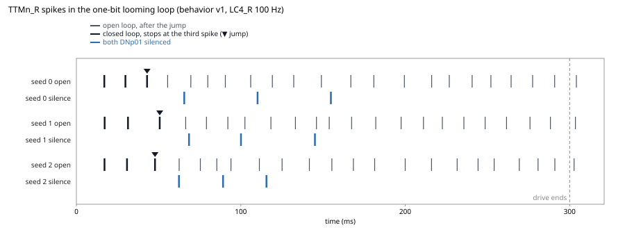
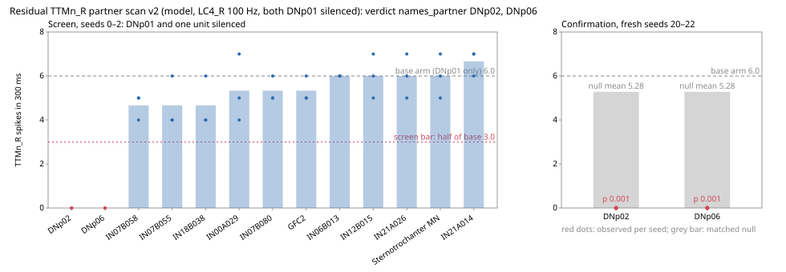
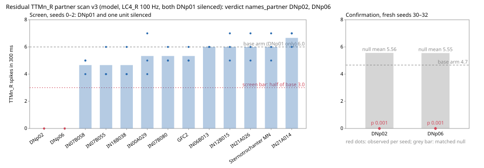
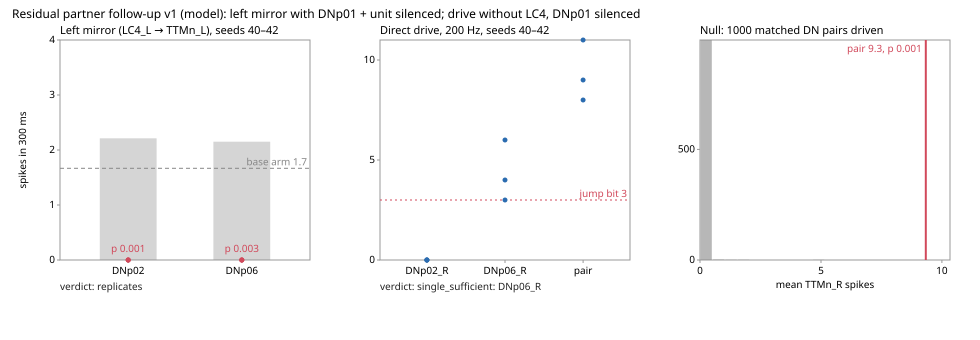

# One-bit looming jump

Issue #8 asks for one closed loop in which an action changes the sensory input
that follows it. This note freezes that task on 2026-10-11. The lock is
[`validation/behavior.yaml`](../validation/behavior.yaml) (version 1). Changing
the task, the body, a deciding check, or a FlyBody number requires a new
version.

`flymsg behavior` prints the protocol and returns before loading the
connectome. `flymsg behavior --run` executes that loop at the default
parameters. Criterion v4, N1, and
[`validation/benchmarks.yaml`](../validation/benchmarks.yaml) stay as they are.
The looming case is not added again to `validate.CASES`.

## Verdicts

Three locked questions share this page. Each section below keeps its protocol and its
numbers. The limits under the one-bit task belong to that protocol.

| Question                            | Verdict                                                 | Section                                   |
| ----------------------------------- | ------------------------------------------------------- | ----------------------------------------- |
| One-bit loop, both DNp01 silenced   | fails: `TTMn_R` still reaches 3 spikes                  | [Result (2026-10-11)](#result-2026-10-11) |
| Residual partner of that drive      | DNp02 and DNp06, replicated                             | [scan](#residual-partner-scan)            |
| Left side, and either partner alone | the mirror replicates; DNp06 alone reaches the jump bit | [follow-up](#residual-partner-follow-up)  |

## Result (2026-10-11)

The closed loop fails. `w_syn` stayed 0.192 and `th_jump` stayed 0. Seeds 0–2.
The protocol file was not edited after the numbers. The run started from commit
`96cee3b` with the runner still uncommitted, so the manifest records that
commit as dirty. The loop itself took 90.5 s. Same MaleCNS tables as the
held-out run.

Each seed has two rows. The triangle is `t_jump`, and the closed loop has no
spike after it. With both `DNp01` silenced, `TTMn_R` still reaches three
spikes, later and inside the 300 ms drive. These times are not a takeoff latency.

| Check           | Result                                                                                                                                              |
| --------------- | --------------------------------------------------------------------------------------------------------------------------------------------------- |
| `jump`          | pass. `t_jump_ms` is 43.0, 50.7 and 47.8 ms, so 3/3 seeds are inside 300 ms. The median is 47.8 ms                                                  |
| `feedback`      | pass. The drive stops on the step after the third `TTMn_R` spike. The closed stimulus is 431, 508 and 479 steps                                     |
| `decoder_match` | pass. Spike times through `t_jump` match the open loop: 17.0/29.8/43.0, 17.2/31.4/50.7 and 17.1/30.8/47.8 ms                                        |
| `silence`       | fail. With both `DNp01` silenced, `TTMn_R` still emits 3 spikes, at 65.6/110.2/154.8, 68.5/100.1/145.1 and 62.4/89.2/115.6 ms, and the drive is cut |

Jump, feedback, and the decoder prefix hold. Silencing both giant-fiber neurons
does not keep `TTMn_R` at or below 2 spikes. The third spike is later than in
the intact loop, and it still arrives inside the 300 ms drive, so the jump rule
cuts that drive. That is the finding. It is not a retune.

With the drive left on, each seed has 22 `TTMn_R` spikes. With the cut, the
closed loop stops at the three spikes above. `DNp01(GF)_R` fires first, at 4.8,
4.9 and 5.1 ms, and `DNp01(GF)_L` at 12.4, 12.9 and 12.5 ms, both before
`TTMn_R`. On the closed loop, no neuron is still firing from 400 ms to 600 ms.
The v4 limit of 100 does not decide, and these rows do not rescue silence.
The times are the model under a 100 Hz Poisson drive. They are not a takeoff
latency.

`gf_required_for_the_jump_bit` stays `unverified`. The silence arm failed in
the model. It does not test the animal.

## Task

The task is a one-bit jump on the looming-escape circuit already in the v4
battery.

| Role    | Identity | Count | Where it sits in MaleCNS v1.0          |
| ------- | -------- | ----: | -------------------------------------- |
| Sensory | `LC4_R`  |    55 | superclass `visual_projection`         |
| Command | `DNp01`  |     2 | instances `DNp01(GF)_R`, `DNp01(GF)_L` |
| Motor   | `TTMn_R` |     1 | superclass `vnc_motor`                 |

`LC4_R` is the stimulus of the looming case. That case scores types `DNp01` and
`TTMn`. A unilateral `LC4_R` drive recruits the right-hand motor neuron, so
this protocol names the instance `TTMn_R`. The giant-fiber instances in the
table are `DNp01(GF)_R` and `DNp01(GF)_L`. There is no `DNp01_R` row.

The endpoint is measurable inside the existing simulator. The sensory trace is
the Poisson kick matrix into `LC4_R`. The motor trace is the spike count of the
one `TTMn_R` neuron. The body state is two fields, `escaped` and `t_jump_ms`.
`escaped` becomes true on the first 0.1 ms step at which `TTMn_R` has emitted 3
spikes. From the next step on, the `LC4_R` drive is zero. That cut is the
action changing the sensory input.

The circuit reference is the same one the validation case already cites. LC4
and LPLC2 drive the giant fiber, and the giant fiber drives the jump-muscle
motor neuron (von Reyn et al., _Nat. Neurosci._ 17, 962–970, 2014,
doi:10.1038/nn.3741; Ache et al., _Curr. Biol._ 29, 1073–1081, 2019,
doi:10.1016/j.cub.2019.01.079). The chemical weights already reported for this
case are LC4\*R → DNp01 2580/2580 (sum/max) and DNp01 → TTMn 90/70. On the
traced graph the 90/70 pair is DNp01(GF)\_R → TTMn_R 70 and DNp01(GF)\_L → TTMn_L 20. The 70 is the maximum. It is the reported giant-fiber edge, not the residual
partner. The direct LC4_R → TTMn weight is 0
([validation](validation.md)). Those numbers are why the case was calibratable.
They were not looked up again to choose a target.

Walking, song, grooming, and proboscis extension need a map from motor neurons
onto joints. This repository does not have that map. The held-out olfactory
case ORN_DM1 → DM1_lPN fails specific and stability
([benchmarks](benchmarks.md)), so it is not the substrate. CO2 avoidance stays
unscored. LPLC2, the alternate LC4 routes, MDN, and T4/T5 stay in the
exploratory partition.

## What the result is allowed to mean

Looming escape is in the calibration partition. It took part in choosing
`w_syn`. A closed loop on it is a feasibility demonstration on that circuit.
`claim.status` is `calibration_feasibility` and `held_out` is false. A pass
does not show that the model generalizes, takes off, walks, or sees a loom. A
failure is a finding. `w_syn` and `th_jump` stay at the defaults, N1 is not
redrawn, and the held-out manifest is not edited.

## Body

Two bodies were compared. The numbers for FlyBody were read on 2026-10-11 from
the public repository <https://github.com/TuragaLab/flybody> (default branch
`main`). FlyBody was not installed.

|                             | One-bit jump                         | FlyBody (TuragaLab)                                                                                              |
| --------------------------- | ------------------------------------ | ---------------------------------------------------------------------------------------------------------------- |
| What it is                  | `escaped`, `t_jump_ms`               | MuJoCo fruit fly for physics and reinforcement learning                                                          |
| License                     | this repository, MIT                 | Apache-2.0 (`LICENSE`, GitHub SPDX `Apache-2.0`)                                                                 |
| Paper                       | von Reyn 2014; Ache 2019, as above   | Vaxenburg et al., _Nature_ 643, 1312–1320 (2025), doi:10.1038/s41586-025-09029-4, as cited in the FlyBody README |
| Action                      | one bit, the third `TTMn_R` spike    | README walking example: 59-dimensional action                                                                    |
| Tasks in the tree           | this protocol                        | `walk_imitation`, `walk_on_ball`, `flight_imitation`, `vision_flight`                                            |
| Timestep                    | no body step; neural `dt` is 0.1 ms  | see the coupling table below                                                                                     |
| Controller                  | the traced LIF, `learned: false`     | README training path is a DMPO agent (Acme, TensorFlow, Ray)                                                     |
| Install named by the README | none added                           | conda, Python 3.10, optional CUDA 11.8                                                                           |
| Connectome                  | MaleCNS v1.0, 165,122 traced neurons | no MaleCNS motor-neuron label on the 59 walking actions                                                          |
| Sex                         | male connectome                      | not stated in the README, `tasks/constants.py`, or the head of `fruitfly.xml`                                    |

FlyBody's published tasks are locomotion and flight. The task list has no
looming-jump environment. Vision-guided flight observes a rendered camera. It
does not take `LC4_R` spikes. Nothing read on that day maps `TTMn_R` onto a
tergotrochanter actuator, or a MaleCNS motor neuron onto an action coordinate.

A re-read on 2026-10-12 of FlyBody commit `d015e9b` (2025-07-30) found the same
timesteps. The 59 walking actions in that commit's `docs/getting-started.ipynb`
are named actuators: claw adhesion, head, abdomen, and leg joints through
`tarsus2`. Wings and mouth are off. No name is a MaleCNS motor neuron. The
Nature paper states that the reconstructed body is a female fly, and the
supplementary masses are the mean of 52 females. The README,
`tasks/constants.py` and the head of `fruitfly.xml` still do not state the sex.
`pyproject.toml` there
allows Python >=3.10 and pins `numpy==1.26.4`. Issue
[#19](https://github.com/gianlucamazza/flymsg/issues/19) records the re-read.
It does not select FlyBody. Issue
[#20](https://github.com/gianlucamazza/flymsg/issues/20) left the residual
`TTMn_R` partner unnamed. The scan below named it. The authored map is
[`validation/motor_map.yaml`](../validation/motor_map.yaml). Every actuator and
both `TTMn` neurons are `unmapped`. A command is refused. It does not select
FlyBody.

The documented FlyBody install is Python 3.10 plus optional TensorFlow, Acme,
Ray, and CUDA. flymsg requires Python 3.13 and does not depend on MuJoCo.
Compatibility of the two environments was not established, and no FlyBody
runtime was measured. A DMPO policy would be a learned controller. Issue #8
keeps any learned controller out of the mechanism under test.

The selected body is the one-bit jump. FlyBody stays related work. It is not a
dependency of this version.

## Encoding and decoding

Defaults are criterion v4 and `sim.Params`. `w_syn` is 0.19230769230769232 and
`th_jump` is 0. Seeds are 0, 1, and 2.

| Piece         | Value                                                                   | Provenance                             | Assumption                                                                                  |
| ------------- | ----------------------------------------------------------------------- | -------------------------------------- | ------------------------------------------------------------------------------------------- |
| Drive         | Poisson, 100 Hz, for 300 ms unless the jump cuts it                     | `validate.RATE_HZ`, `validate.STIM_MS` | this is not a loom. Ache et al. encode size and velocity in LC4. No loom waveform is copied |
| Step          | 0.1 ms                                                                  | `sim.Params.dt`, Shiu et al. 2024      |                                                                                             |
| Run length    | 600 ms                                                                  | `validate.DURATION_MS`                 |                                                                                             |
| Generator     | one `numpy` `default_rng(seed)` draw for the 300 ms window, then a mask | same draw order as `sim.run`           |                                                                                             |
| Jump bit      | first step at which `TTMn_R` has emitted 3 spikes                       | `validate.MIN_SPIKES`                  | 3 spikes are the v4 floor, not a measured muscle tension                                    |
| Cut           | `LC4_R` kicks are zero on every step strictly after that step           | this protocol                          | the kick on the jump step itself is still the open-loop draw                                |
| Silence set   | both `DNp01` neurons                                                    | the giant fiber pair                   | the contralateral fiber is included. The protocol does not test the right fiber alone       |
| Gap junctions | absent, as in the rest of flymsg                                        | [model](model.md)                      | the giant fiber here is the chemical path                                                   |

`LC4` has no `class` value in MaleCNS v1.0. Its superclass is
`visual_projection`. The class-matched sensory control of criterion v4 is not a
deciding check here.

The kernel decides a spike before it adds that step's Poisson kick
(`sim._kernel`, threshold, then delivery, then the kick). The third `TTMn_R`
spike therefore does not depend on the kick of its own step. Zeroing kicks
after that step is the cut that later spikes can feel.

## Interface

The body state is `{escaped: bool, t_jump_ms: ms or null}`. Each neural step is
0.1 ms. This body has no integrator and no slower step
(`body.timestep_ms: null`).

On the step where the `TTMn_R` count reaches 3, set `escaped` and `t_jump_ms`
to that step's time. Every later step uses a zero kick. If the count never
reaches 3, `escaped` stays false, `t_jump_ms` stays null, and the drive follows
the open-loop 300 ms window.

Replay is fixed by the seed. The runner stores, per seed and per arm:

- the spike-count bins and the first-spike times;
- the `LC4_R` kick matrix after the mask;
- `escaped` and `t_jump_ms`;
- whether `DNp01` was silenced.

The same seed redraws the same open-loop Poisson sequence and applies the mask.
No second random stream is drawn at the cut.

## Coupling

The neural step stays 0.1 ms. A future body step is eligible only when its
duration is an integer multiple of 0.1 ms and at least one neural step, and
when the sensory input is held constant across the neural steps inside it.
`behavior.integer_multiple` is that test. This version checks the frozen
FlyBody numbers with it. It does not step MuJoCo.

| Source, read 2026-10-11                       | Value    | In 0.1 ms steps | Eligible later |
| --------------------------------------------- | -------- | --------------- | -------------- |
| `fruitfly.xml` `<option timestep>`            | 0.0001 s | 1               | yes            |
| `tasks/constants.py` `_WALK_PHYSICS_TIMESTEP` | 0.0002 s | 2               | yes            |
| `_WALK_CONTROL_TIMESTEP`                      | 0.002 s  | 20              | yes            |
| `_FLY_PHYSICS_TIMESTEP`                       | 5e-5 s   | 0.5             | no             |
| `_FLY_CONTROL_TIMESTEP`                       | 0.0002 s | 2               | yes            |

The asset file's 0.1 ms option is not the task step. Walking and flight
override it. Flight's physics step is finer than the neural step, so it fails
the rule. Walking's physics step is two neural steps, and its control step is
twenty. Neither is implemented. The selected body declares no second step, so
there is no coupling left to integrate.

## Deciding checks

All four are required. Seeds 0–2. The default parameters only. A run that has
not happened cannot pass them.

| Check           | Passes when                                                                                                              |
| --------------- | ------------------------------------------------------------------------------------------------------------------------ |
| `jump`          | `t_jump_ms` is at or before 300 ms in at least 2 of 3 seeds                                                              |
| `feedback`      | on every seed that jumps, kicks after `t_jump` are zero and kicks through `t_jump` equal the open-loop draw of that seed |
| `silence`       | with both `DNp01` neurons silenced, `TTMn_R` stays at or below 2 spikes in every seed, and the drive is not cut          |
| `decoder_match` | on every seed that jumps, `TTMn_R` spike times at or before `t_jump` equal the feedback-disabled trace of the same seed  |

`decoder_match` is an integrity check on the mask. The dynamics are causal and
the kicks match through `t_jump`, so the prefix has to match. A mismatch means
the runner is not this protocol.

## Reported, and not decisive

| Record              | What is stored                                                                                                    |
| ------------------- | ----------------------------------------------------------------------------------------------------------------- |
| `feedback_disabled` | open loop, stimulus fixed at 300 ms, same seeds. This is the trace `decoder_match` reads                          |
| `latency`           | first-spike times and `t_jump_ms`, in milliseconds. They are not scored against a published takeoff time          |
| `stability`         | mean number of neurons still firing from 400 ms to 600 ms, next to the v4 limit of 100. The count does not decide |
| `order`             | whether `DNp01` fires before `TTMn_R`. Descriptive                                                                |

The open-loop arm cannot rescue a failed closed loop. No biological latency is
copied into a threshold. The 100 Hz Poisson drive is not the loom those papers
used.

## Wiring

No new shuffle is drawn. N1 already ran looming escape on one
degree-preserving shuffle of `post`, seed 0. Every specific check that passes
on the real graph fails on that shuffle, and the looming specific check is one
of them ([related](related.md)). A further wiring arm would be a second draw
after that result. `wiring.draw` is false.

## Prediction

`gf_required_for_the_jump_bit` is unverified. The statement is that silencing
both giant-fiber neurons keeps `TTMn_R` below 3 spikes while `LC4_R` is driven
at 100 Hz for 300 ms. The silence arm tested that statement in the model and
failed: `TTMn_R` still reaches 3 spikes. The label stays `unverified` because
the arm does not test the animal. von Reyn et al. 2014 is the behavioral
citation already used to choose the looming case. King and Wyman 1980 describes
the anatomy of the pathway. It is not a silencing measurement. Until an
independent animal measurement is brought in under a new version, the prediction
stays `unverified` and `tests_animal: false`.

The equality of the closed-loop prefix and the open-loop prefix is the
`decoder_match` check. It is a property of this decoder. It is not a biological
prediction.

## Limits

- One bit on one calibration circuit. Scope stays there.
- An animation of the bit is not acceptance. Acceptance is the four checks above. The run fails silence.
- No full-body fidelity is claimed, and no subjective experience is claimed.
- No learned controller is added, and its contribution is not estimated because it is absent.
- The Poisson rate is not a loom waveform.
- The model has no gap junction on the giant fiber.
- FlyBody's flight physics step is ineligible under the coupling rule. Its walking steps are eligible only as a documented later option.
- The loop took 90.5 s. The closed-loop count of neurons still firing from 400 ms to 600 ms is 0. That count does not decide.
- A failure does not retune `w_syn` or `th_jump`, does not redraw N1, and does not edit the held-out manifest.

## Residual partner scan

Issue [#20](https://github.com/gianlucamazza/flymsg/issues/20) leaves the
partner that still drives `TTMn_R` with both `DNp01` silenced unnamed. This
section freezes the measurement that would name it. The lock is
[`validation/silence_scan.yaml`](../validation/silence_scan.yaml) (now version 3; version 1 is the file at v0.8.16, version 2 at v0.8.27).
The candidate rule, the screen, the draw count, the p and the verdict are code
in `src/flymsg/silence_scan.py`, tested on synthetic graphs. `flymsg
silence-scan` prints the protocol and does not load the connectome; `--run`
executes it with `--workers` and `--checkpoint`. The runner was committed
before the scan ran. Version 1 of the one-bit protocol is not edited.

### Result of version 1 (2026-10-12)

**Verdict: none.** The run started from `6709f13` (v0.8.17, clean) and took 2 h 46 min.
Its manifest records `7d939b2`: until v0.8.27 a manifest took the git state when the run
ended, and the checkout had moved meanwhile. The code that ran is `6709f13`.

The base arm (both `DNp01` silenced) gave `TTMn_R` 7, 5 and 6 spikes on seeds 0–2 and 5, 6
and 7 on seeds 10–12. Thirteen units met the candidate rule. Two passed the screen:

| Unit  | Neurons | Synapses onto `TTMn_R` | Screen, seeds 0–2 | Confirm, seeds 10–12 | Null mean | p     |
| ----- | ------: | ---------------------: | ----------------- | -------------------- | --------: | ----- |
| DNp02 |       2 |                     21 | 0, 0, 0           | 0, 0, 0              |      5.22 | 0.036 |
| DNp06 |       2 |                     35 | 0, 0, 0           | 0, 0, 0              |      5.26 | 0.041 |

The other eleven stayed between 4.7 and 6.7 spikes. With _m_ = 2 the threshold is 0.025, so
neither unit `contributes` and neither `names_partner`, although each one, silenced with
`DNp01`, removed every `TTMn_R` spike in all six seeds. Report: `results/silence-scan/v1/` (archived from `runs/`).

**Post-hoc, exploratory** (`scripts/silence_scan_posthoc.py`, after the verdict). The v1
null pool excluded only the tested unit. Of the 1,000 draws for DNp02, 35 reached 0 spikes,
and 35 contained DNp06_R (bodyId 10584); 48 contained DNp06_L. Of the 1,000 draws for
DNp06, 40 reached 0 spikes, and 40 contained DNp02_R (10117); DNp02_L was not a responder.
The counts coincide; per-draw values were not kept, so the identity of the draws is not
shown. The reading is that the null for each unit was contaminated by the other, and that
the right-hand neuron of each matters. It does not change the verdict.

### Version 2 (fixed 2026-10-12, after the v1 verdict, before its run)

Version 2 changes one rule and the seeds: the null pool also excludes every other unit that
passed the screen, and confirmation runs on fresh seeds 20–22 (not 10–12). Candidate rule,
screen, draw count, threshold and verdicts are those of version 1. The lock records what it
supersedes and why. Being written after the v1 result is disclosed here; the v2 confirmation
had not run when the lock was committed. A test checks that no null draw for one screen pass
can silence another.

### Result of version 2 (2026-10-12)

**Verdict: names_partner: DNp02, DNp06.** The run started from `764af9e` (v0.8.27, clean,
in a separate worktree) and took 2 h 33 min; its manifest records the same commit.

The base arm gave `TTMn_R` 7, 5 and 6 spikes on screen seeds 0–2 and 6, 6 and 6 on confirm
seeds 20–22. The same thirteen candidates as in version 1; the same two passed the screen:

| Unit  | Screen, seeds 0–2 | Confirm, seeds 20–22 | Null mean | p     | Outcome         |
| ----- | ----------------- | -------------------- | --------: | ----- | --------------- |
| DNp02 | 0, 0, 0           | 0, 0, 0              |      5.28 | 0.001 | `names_partner` |
| DNp06 | 0, 0, 0           | 0, 0, 0              |      5.28 | 0.001 | `names_partner` |

With the other screen pass out of the pool, no draw reached the observed 0 spikes, so p is
the smallest the 1,000 draws allow, below the 0.025 threshold. Report:
`results/silence-scan/v2/` (archived from `runs/`).

**Reading.** In the model, with both `DNp01` silenced, `TTMn_R` is driven through DNp02 and
DNp06: silencing either one removes every spike on all nine seeds of both versions. Each is
necessary for the residual drive here; neither alone is shown sufficient, and combinations
were not searched. The seed 0 replays on the site add one exploratory observation: with
DNp02 silenced as well, DNp06_R still fires 27 times and `TTMn_R` none; with DNp06 silenced,
DNp02_R still fires 59 times and `TTMn_R` none. In this model `TTMn_R` needs both inputs
together, not either one alone. Compare
[DNp01 against DNp01 + DNp02](https://gianlucamazza.github.io/flymsg/live/dnp01-vs-dnp02/?run=difference&t=60&paused&select=800146)
and [DNp01 against DNp01 + DNp06](https://gianlucamazza.github.io/flymsg/live/dnp01-vs-dnp06/?run=difference&t=60&paused&select=800146).
Three limits hold. Version 2 was written after the version 1 result was seen,
although before its own run; a replication on further fresh seeds would remove that doubt.
The result is about this LIF on MaleCNS, not the fly. `gf_required_for_the_jump_bit` stays
`unverified`, and version 1 of the one-bit protocol is not edited.

### Version 3 (replication, fixed 2026-10-12, before its run)

Version 2 chose its null rule after the version 1 result was seen. Version 3 repeats version
2 with every rule unchanged and only the confirm seeds moved to 30–32, which no version has
used; the runner refuses seeds 10–12 and 20–22. A test checks against the v0.8.27 file that
nothing else changed. The screen runs on seeds 0–2 again, so it selects the same units by
construction.

Failure rule, fixed here before the run: if DNp02 or DNp06 does not reach `names_partner`,
the v2 naming is reported as not replicated, #20 is reopened with both results, and neither
run is dropped. If both reach it, the naming is reported as replicated on fresh seeds and
stays model-side.

One description is added and decides nothing: in each confirm arm, the spikes of the other
screen pass per seed (DNp06 when DNp02 is silenced, and the reverse). It turns the seed 0
observation that `TTMn_R` needs both into three seeds, with no test attached.

### Result of version 3 (2026-10-12)

**Verdict: names_partner: DNp02, DNp06. The v2 naming replicates on fresh seeds.** The run
started from `1bbf60e` (the lock on `main`, clean, in a separate worktree) and took 2 h 23
min; its manifest records the same commit.

The base arm gave `TTMn_R` 7, 5 and 6 spikes on screen seeds 0–2 and 5, 4 and 5 on confirm
seeds 30–32. The screen selected the same thirteen candidates and the same two passes:

| Unit  | Confirm, seeds 30–32 | Null mean | p     | Other pass, spikes per seed | Outcome         |
| ----- | -------------------- | --------: | ----- | --------------------------- | --------------- |
| DNp02 | 0, 0, 0              |      5.56 | 0.001 | DNp06: 45, 50, 46           | `names_partner` |
| DNp06 | 0, 0, 0              |      5.55 | 0.001 | DNp02: 59, 59, 58           | `names_partner` |

The failure rule did not apply. The descriptive column, which decides nothing, extends the
seed 0 observation to three seeds: with either unit silenced the other keeps firing and
`TTMn_R` stays at 0, so in this model `TTMn_R` needs both inputs together. Across versions 2
and 3, silencing either unit with both `DNp01` removes every `TTMn_R` spike on twelve seeds.
The runner keeps only the null mean and p, not the value of each draw, so the null
distribution is not archived. Report: `results/silence-scan/v3/`.

The limits of version 2 that remain: the result is about this LIF on MaleCNS, not the fly;
`gf_required_for_the_jump_bit` stays `unverified`; version 1 of the one-bit protocol is not
edited. What would test it on the animal is in
[#36](https://github.com/gianlucamazza/flymsg/issues/36).

### Protocol (all versions)

**Blind.** The 2026-10-12 listing of `TTMn_R` inputs was read before this
lock, so it chooses nothing. No unit is named here. The runner computes the
set from the rule, and the set is reported before the confirmatory stage
starts.

**Arm.** The behavior v1 silence arm: `LC4_R` at 100 Hz, both `DNp01` silenced,
`w_syn` 0.192, `th_jump` 0. The drive is not cut. The statistic is the number
of `TTMn_R` spikes during the 300 ms drive, averaged over seeds. Runs stop at
300 ms because nothing after the drive is read.

**Candidates.** A unit is a cell type, and a neuron without a type is its own
unit. A unit is a candidate when its neurons together make at least 5 synapses
onto `TTMn_R` (the v4 control weight) and at least one of them fires during
the drive in 2 of 3 screen seeds of the base arm. A silent unit cannot change
the run, so leaving it out does not change the answer. The whole unit is
silenced, except `LC4_R`, `TTMn_R` and `DNp01`. Inhibitory units stay in. There
is no cap. Every route into `TTMn_R` ends on a direct chemical input, so the
scan covers every single-type route the model has.

**Screen** (seeds 0–2, no null, does not decide). A unit passes when the mean
`TTMn_R` count with `DNp01` and the unit silenced is at or below half of the
base-arm mean. The half is a choice made here, not a measured value. If the
base arm already keeps `TTMn_R` at or below 2 spikes in every seed, nothing is
named on those seeds.

**Confirmation** (fresh seeds 10–12). Each of the _m_ units that pass the
screen is tested against the T2/T3 null: as many of the base arm's responders
on these seeds, matched on superclass and transmitter sign, never `LC4_R`,
`TTMn_R`, `DNp01` or the tested unit. `DNp01` stays silenced in every draw.
Draws per unit are max(1000, 20 _m_), so the smallest p, 1/(1 + draws), is
below 0.05/_m_. p = (1 + draws whose mean count is at or below the observed
mean) / (1 + draws). A unit whose matched pool is short is reported without a
p and cannot pass.

| Outcome         | When                                                                      |
| --------------- | ------------------------------------------------------------------------- |
| `contributes`   | p ≤ 0.05/_m_ (Bonferroni over the screen passes)                          |
| `names_partner` | contributes, and `TTMn_R` emits at most 2 spikes in every confirm seed    |
| `none`          | _m_ is 0, or no unit contributes. The residual drive is not one cell type |
| `no_residual`   | the base arm keeps `TTMn_R` at or below 2 spikes in every seed of a stage |

`names_partner` is the behavior v1 silence bar applied with the unit silenced
as well. A unit that contributes without reaching it is a contribution, not
the partner. `none` is a finding. Combinations of units are not searched in
this version, and neither are gap junctions, a retune, a redraw of N1 or an
edit of the held-out manifest. `gf_required_for_the_jump_bit` stays
`unverified`: the scan is model-side.

**Cost, measured 2026-10-12 under load 13.** A 300 ms run takes 3.8 s on one
worker. The screen is three runs per candidate plus three base runs. Each
confirmed unit needs 3 × max(1000, 20 _m_) runs, about 3.2 h on one worker at
1000 draws. The run will use `--checkpoint`.

## Residual partner follow-up

Scan v3 names DNp02 and DNp06 on the right side and shows that each is necessary. Issue
[#76](https://github.com/gianlucamazza/flymsg/issues/76) asks two more questions of the
model, locked in
[`validation/partner_followup.yaml`](../validation/partner_followup.yaml) before any run.
The runner is `src/flymsg/partner_followup.py`, tested on synthetic graphs. `flymsg
partner-followup` prints the protocol; `--run` executes it on seeds 40–42.

### Seen before the lock: the mirrored arms (exploratory)

`scripts/silence_mirror.py` ran the scan arms on both sides, seeds 0–2, after the v3 verdict.
The right side reproduces the scan base arm. `TTMn` spikes during the 300 ms drive:

| Silenced                                  | `LC4_R` → `TTMn_R` | `LC4_L` → `TTMn_L` |
| ----------------------------------------- | ------------------ | ------------------ |
| nothing                                   | 21, 21, 21         | 11, 11, 10         |
| DNp01                                     | 7, 5, 6            | 2, 1, 3            |
| DNp01 + DNp02 (both sides)                | 0, 0, 0            | 0, 0, 0            |
| DNp01 + DNp06 (both sides)                | 0, 0, 0            | 0, 0, 0            |
| DNp01 + DNp02 and DNp06 of the same side  | 0, 0, 0            | 0, 0, 0            |
| DNp01 + DNp02 and DNp06 of the other side | 4, 5, 5            | 0, 2, 2            |

The scan silenced each type on both sides; here the effect follows the pair on the side of
the stimulus. The left side is weaker: `TTMn_L` receives 2,424 synapses against 3,608 for
`TTMn_R`, and with DNp01 silenced only 1–3 spikes remain, close to the 2-spike bar.

### Version 1 (fixed 2026-10-12, before its run)

**Left.** The scan's silence arm mirrored (`LC4_L` at 100 Hz, both `DNp01` silenced,
`TTMn_L`), testing only DNp02 and DNp06 with the scan's matched-responder null (1,000
draws, lower tail, α 0.05 / 2). Verdict: `replicates` if both reach `names_partner`,
`partial` if one does, `not_replicated` if neither, `no_residual` if the base arm already
stays at 2 spikes or fewer, and `undetermined` if a null is not defined. Because the base
arm is weak, `no_residual` is a likely outcome and is stated here as one.

**Drive.** No LC4 and both `DNp01` silenced. `DNp02_R`, `DNp06_R` and the pair are driven
directly at 200 Hz for 300 ms, about the rate each fired during the looming drive in the v3
partner counts. An arm reaches the jump bit with at least 3 `TTMn_R` spikes in every seed.
The pair is compared with 1,000 pairs of descending cholinergic neurons (DNp01, DNp02, DNp06
excluded) driven the same way, upper tail. Verdicts, in order: `single_sufficient` if either
alone reaches the bar; `insufficient` if the pair does not; `not_specific` if the pair does
but p is above 0.05; `conjunction` if both single arms stay at 2 spikes or fewer; otherwise
`pair_sufficient`.

Every null draw is kept (`null_draws.csv`). The run starts from a commit on `main`. Results
stay model-side; `gf_required_for_the_jump_bit` stays `unverified`.

### Result of version 1 (2026-10-13)

The run started from `39b53a5` on `main` (clean, in a separate worktree) and took 3 h 30 min
under load.

**Left: `replicates`.** The mirrored base arm gave `TTMn_L` 3, 1 and 1 spikes on seeds 40–42,
a weak residual as expected. With DNp02 or DNp06 silenced as well, `TTMn_L` stays at 0 on all
three seeds: p 0.001 (null mean 2.21) and p 0.003 (null mean 2.15), both below 0.025. The
naming holds on the other side.

**Drive: `single_sufficient: DNp06_R`.** Driven at 200 Hz without LC4 and with DNp01 silenced,
`TTMn_R` fires 0, 0, 0 with `DNp02_R` alone, 3, 4, 6 with `DNp06_R` alone, and 9, 8, 11 with
the pair; 1,000 matched descending-neuron pairs give a mean of 0.013 (p 0.001). The
conjunction hypothesis is rejected: DNp06 alone reaches the jump bit at the driven rate, and
DNp02 adds to it. Read with the scan: during looming DNp06_R fires about 150 Hz (45–50 spikes
in 300 ms), below the driven 200 Hz, so silencing DNp02 removes the drive it needs; that is
why each is necessary in the looming arm. The pair is specific: random descending pairs
almost never drive `TTMn_R`.

Outputs: `results/partner-followup/v1/` (with every null draw).
