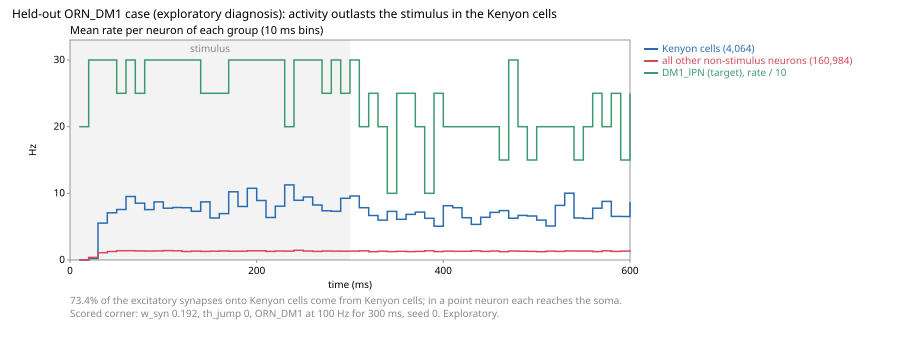

# Held-out benchmarks

Issue #7 asks for circuits that were not used to choose the model, and for a
sensitivity check that is not a retune. This note freezes that partition on
2026-10-11, before any held-out simulation. The lock is
[`validation/benchmarks.yaml`](../validation/benchmarks.yaml) (version 1). Changing a
held-out case, a check, or a sensitivity corner requires a new version. Criterion v4
stays the baseline: `flymsg validate` is unchanged, and N1 is not redrawn.

`flymsg benchmarks` prints the frozen confirmatory case. `flymsg benchmarks --run`
scores that case and the reported case at the scored corner. It does not edit the
manifest, criterion v4, or N1.

## Result (2026-10-11)

The scored run fails. `w_syn` stayed 0.192 and `th_jump` stayed 0. Seeds 0–2, control
seed 0. The manifest was not edited after the numbers. Both sensitivity corners fail
the same two checks. Neither replaces this result.

| Case              | Check     | Result                                                                               |
| ----------------- | --------- | ------------------------------------------------------------------------------------ |
| ORN_DM1 → DM1_lPN | positive  | pass. 284.4 Hz, 3/3 seeds, median first spike 3.4 ms                                 |
| ORN_DM1 → DM1_lPN | specific  | fail. Target 284.4 Hz, control 185.6 Hz. Intervals [283.3, 286.7] and [173.3, 193.3] |
| ORN_DM1 → DM1_lPN | stability | fail. 4894 neurons still fire from 400 ms to 600 ms; the limit is 100                |
| ORN_V → V_ilPN    | positive  | pass. 264.4 Hz, first spike 4.4 ms. Does not decide                                  |
| ORN_V → V_ilPN    | specific  | fail. Control 225.6 Hz, interval [223.3, 230.0] against [260.0, 266.7]               |
| ORN_V → V_l2PN    | positive  | pass. 116.7 Hz, first spike 9.2 ms. Does not decide                                  |
| ORN_V → V_l2PN    | specific  | fail. Control 95.6 Hz, interval [90.0, 100.0] against [116.7, 116.7]                 |
| ORN_V → V PNs     | stability | fail. 4833 neurons still fire. Does not decide                                       |

The specific check needs the class-matched control at or below 94.1 Hz for DM1_lPN.
The control is other olfactory neurons, the same count, excluding the targets and
their strong inputs. DM1_lPN does fire. A same-sized olfactory drive fires it too, and
the activity does not die out. That is the finding.

ORN_V is the same pattern on the reported case. It does not rescue DM1, and it does
not score CO2 avoidance.

These rates are the model under a 100 Hz Poisson input for 300 ms. They are not a
match to an odor recording. The first-spike times are the model's medians, not a claim
about the odor puffs in Kazama and Wilson.

The numbers are from one run on 2026-10-11. The scorer was not committed yet, so
`runs/benchmarks/manifest.json` records git `51b5305` with a dirty tree. The result
itself is commit `b3e1859`. The csv and the manifest stay in `runs/`, outside git.
Dataset file hashes are in that manifest.

## Sensitivity (2026-10-11)

`flymsg benchmarks --corners` ran the two frozen rows and did not rerun the scored
corner. Seeds 0–2, control seed 0, same two cases. The manifest hash is unchanged.

| Corner       | w_syn | th_jump | DM1_lPN        | Control | Still firing |
| ------------ | ----: | ------: | -------------- | ------: | -----------: |
| scored       | 0.192 |       0 | 284.4 Hz, pass |   185.6 |         4894 |
| Shiu weight  | 0.275 |       0 | 301.1 Hz, pass |   200.0 |         7797 |
| adaptation A | 0.192 |       2 | 185.6 Hz, pass |   105.6 |         2669 |

Specific fails in every row: the control stays above the bar (99.7 Hz at the Shiu
weight, 61.2 Hz with adaptation). Stability fails in every row. Confirmatory verdict
at both corners: FAIL. The scored failure survives both perturbations.

ORN_V stays reported. At the Shiu weight, V_ilPN is 287.8 Hz against 252.2 Hz and
V_l2PN is 131.1 Hz against 104.4 Hz, with 7883 neurons still firing. With adaptation,
V_ilPN is 165.6 Hz against 125.6 Hz and V_l2PN is 75.6 Hz against 51.1 Hz, with 2685
neurons still firing. Positive passes. Specific and stability fail. It does not decide.

The corner run started from commit `490c32b` with this command still uncommitted, so
its manifest records a dirty tree. The csv is `runs/benchmarks/corners/report.csv`.

## Why activity outlasts the stimulus (exploratory, 2026-10-12)

Not a scored result and not a retune; `scripts/orn_persistence.py` reproduces it with
`flymsg.tracing`. The scored corner (`w_syn` 0.192, `th_jump` 0, 100 Hz for 300 ms, seed 0)
leaves 4,907 neurons firing from 400 to 600 ms. Most are Kenyon cells of the mushroom body:
495 KCg-m, 213 KCab-m, 152 KCab-c and 69 KCab-s (28–32 Hz late), with PAM dopaminergic
neurons, the local neuron lLN1_bc (303 Hz), HRN_VP1d and VM5d_adPN among the rest.

Recording one neuron of each leading type shows the drive does not decay after the stimulus:
the synaptic drive `g` of a KCg-m neuron is 13.0 mV during the stimulus and 13.5 mV from 400
to 600 ms, and 67–79% of the excitatory synapses onto the recorded Kenyon cells come from
neurons that are themselves still firing. Across all 4,064 Kenyon cells, 73.4% of the
excitatory synapses they receive come from other Kenyon cells. In a point neuron every one of
those synapses reaches the soma, so the Kenyon cells excite each other into a loop that
outlasts the input. The two APL neurons send 196,200 inhibitory synapses onto Kenyon cells,
but here APL is a spiking point neuron.

This points at a model limit, not a fitted fix. In the fly, Kenyon cell–Kenyon cell synapses
are mostly axo-axonal in the lobes, and APL gives graded, non-spiking feedback inhibition
that keeps Kenyon cell activity sparse (Lin et al., _Nat. Neurosci._ 17, 559–568, 2014,
doi:10.1038/nn.3660). Neither has a parameter in this LIF. A model change would need its own
pre-registered test on cases it was not chosen on.

## Pulse vs sine song across neuropils (lock, 2026-10-14, #36)

The first held-out benchmark of M4 ([#36](https://github.com/gianlucamazza/flymsg/issues/36)):
per central-brain neuropil of male flies, does the connectome predict the sign of the
preference for pulse over sine song that Pacheco et al. 2021 imaged (doi:10.1038/s41593-020-00743-y;
data doi:10.34770/gv6w-5351, CC BY 4.0)? `validation/song.yaml` v1, locked before any run and
before any response value of the data was read.

- **Input, temporal only.** Johnston's organ JO-A, JO-B and JO-D on both sides (146 neurons)
  get the same input in three conditions that differ only in time: pulse (16 ms on, 20 ms off,
  10 s, the paper's stimulus), sine (constant) and an aperiodic train (the same pulses at random
  places, at least two refractory periods apart). Kicks pass one refractory period of dead time
  and are subsampled per neuron to the same count in every condition, so each JO neuron gets the
  same number of kicks (its spikes are reported). The
  mapping "JO-A ≈ pulse, JO-B ≈ sine" is not supported by its sources (Kamikouchi et al. 2009,
  Matsuo et al. 2014, Ohashi et al. 2023), and the model has no carrier frequency, so the claim
  is the envelope-driven part of selectivity only; white noise is not scored.
- **Model readout.** Per neuropil, spike counts over the 12 s window (train and 2 s after, the
  paper's) weighted by each neuron's synaptic connections there (MaleCNS `primary_post`, left
  and right pooled); the driven JO neurons are left out. Index (pulse − sine)/(pulse + sine)
  per seed; the prediction is the sign of the seed median. Rates 50, 100 and 200 Hz (nominal;
  the delivered rate is reported); the verdict at 100 Hz.
- **Data target.** The paper's response magnitude per male ROI (baseline −4 to −0.5 s,
  80th or 20th percentile of the baseline-subtracted signal from onset to 2 s after offset),
  the same index, the median per fly, and a sign per neuropil when at least four flies and two
  thirds of them agree. AMMC, SAD, WED and GNG are excluded (receptor-near), as are the five
  tracts without a MaleCNS region.
- **Bar.** Balanced accuracy (a constant prediction scores 0.5) against a permutation of the
  model's signs and against 99 degree-preserving shuffled connectomes, p ≤ 0.05 each; `pass`
  also needs the periodic train to beat the aperiodic one, otherwise `pass_burst_only`. The real
  model, every shuffle and the aperiodic train are scored on the same neuropils by the same rule.
- **No-go, model only.** If fewer than half of the scorable neuropils resolve a sign (every seed
  agreeing), or the resolved ones all prefer the same song, the run stops before the data file
  is opened and is recorded as uninformative.
- **Secondary, reported.** JO-A and JO-B weighted by their measured response ratio (Yamakoshi
  et al. 2025, doi:10.1016/j.isci.2025.113232, data 10.17632/29hpr3nrrv): females, a pan-JO
  driver with two ROIs, a 167 Hz carrier and a 100 Hz tone for the sine.

`flymsg song` prints the lock; `--run` runs the model, its no-go, then the data. No run yet.

## Looming → giant fiber timing (lock, 2026-10-15, #34)

The first scored test of the looming transducer (gate G3 of the
[sensorimotor plan](sensorimotor-environment-plan.md),
[#34](https://github.com/gianlucamazza/flymsg/issues/34)): does the connectome's giant fiber
(DNp01) peak at the right time before a looming disc's collision? Dombrovski et al. 2025
(doi:10.1038/s41586-025-09037-4) deposited the giant fiber's whole-cell potential to discs at
r/v 10, 20, 40 and 80 ms (Zenodo 10.5281/zenodo.14983850, CC BY 4.0).
`validation/gf_looming.yaml` v1 is locked before the files are downloaded, except the two an
agent had opened during the search (recorded in the lock).

- **Stimulus.** A dark disc from 10° to 63°, then held, at the four r/v: the protocol of Jang et
  al. 2023 (doi:10.1242/jeb.244790), which the 2025 recordings cite. Its use for them is
  inferred, since they do not restate the sizes.
- **Drive, engineered.** LC4 (126 neurons) fires in proportion to the disc's angular velocity,
  LPLC2 (185) in proportion to its angular size, both sides, each capped at one spike per
  refractory period. These forms follow Ache et al. 2019's description; the gains are scanned
  on a 4 × 4 grid (15 cells with input), because no LC4 or LPLC2 rate to looming is measured.
- **Model readout.** Each giant fiber's potential at every step, filtered as the data; its
  peak time is the first
  sample at 95% of its maximum in the window from onset to 150 ms after the expansion stops, and
  the run's is the mean of the two. Only cells where both giant fibers respond and stay below
  threshold are scored, since the recordings are graded. Per cell the median over five seeds
  and a fit of the peak's time before collision as α · r/v − δ; α fixes the angular size the
  response follows (θ = 2 atan(1/α)).
- **Data target.** Per control fly (10, two trials each), the trial mean, the baseline of the
  1 s before onset and a Savitzky–Golay filter (Jang et al. 2023's), the same peak rule, window
  and fit; a bootstrap interval of the median α over flies.
- **Bar.** `pass` when every scored cell's α lies inside the flies' interval, `partial` when
  some do, `fail` when none does. A peak locked to the stimulus gives α ≈ 1.63 (the expansion's
  end) or 11.43 (its onset) whatever the circuit; if the flies' interval holds either, the run
  is uninformative. δ, the implied angle and the peaks near the expansion's end are reported.
  Amplitudes are never compared.
- **No-go, model only.** If fewer than 4 of the 15 cells respond (one synapse's jump in both
  giant fibers, every seed and r/v) and stay graded, the run stops before any file is opened.
- **Seen before the lock.** During the search an agent opened one control file and the
  deposited spreadsheet; the lock records what was seen. The scored slope was not computed.

`flymsg gf-looming` prints the lock; `--run` runs the model, its no-go, then the data. No run
yet.

## Inventory

Counts are bodies with that cell type in MaleCNS v1.0 (165,122 traced neurons,
CC-BY 4.0). No new recording dataset is downloaded. A **recording** claim is about
spikes or synaptic drive. A **behavioral proxy** is about what the fly does, and is
not turned into a firing rate.

| Candidate            | Primary source                             | Observable                                      | Kind              | Role                    |
| -------------------- | ------------------------------------------ | ----------------------------------------------- | ----------------- | ----------------------- |
| ORN_DM1 → DM1_lPN    | Couto et al. 2005; Kazama & Wilson 2008    | this glomerulus's ORNs recruit its PN (74 → 2)  | recording         | held-out, confirmatory  |
| ORN_V → V PNs        | Suh et al. 2004; Jones et al. 2007         | V ORNs recruit V_ilPN and V_l2PN (55 → 2 and 2) | recording         | held-out, reported      |
| v4 battery           | [validation](validation.md)                | the six cases that chose `w_syn`                | mixed             | calibration             |
| LPLC2 → DNp01        | von Reyn et al. 2014; Ache et al. 2019     | LPLC2 also drives the giant fiber               | recording         | exploratory             |
| LB3a → MN9           | Tastekin et al. 2025                       | water GRNs and proboscis extension              | behavior          | exploratory             |
| LB3d → MN9           | Tastekin et al. 2025                       | high salt, sign depends on concentration        | behavior          | exploratory, not scored |
| LC4 via DNp02, DNp11 | `path --alt` already lists these routes    | other chemical routes from LC4 to TTMn          | graph             | exploratory             |
| GF → DLMn            | Blagburn et al. 1999; Allen & Murphey 2007 | DLM spike; the chemical path reached 4.4 Hz     | recording         | exploratory, excluded   |
| vPR6, vMS11          | [validation](validation.md)                | stay silent under pIP10                         | model observation | exploratory             |
| pCd persistence      | findings log, after P1                     | P1/pCd activity that outlasts the stimulus      | literature state  | exploratory             |
| MDN                  | Bidaye et al. 2014                         | backward walking; MDN is 4 neurons              | behavioral proxy  | not scored              |
| T4 / T5              | Maisak et al. 2013                         | direction selectivity to a moving bar           | recording         | not scored              |
| DN1pA                | type is present (8 neurons)                | circadian phase                                 | hours             | not scored              |

The v4 cases, the silencing tests T1–T4, N1 and the null families are calibration or
already-reported results. They are not held-out. LPLC2 is named in the looming case's
own evidence sentence. LB3a and LB3d were compared by connectivity when the sugar set
was chosen, and MN9 is the calibration readout. The alternate LC4 routes were
enumerated by `path`. GF → DLMn, vPR6, vMS11 and pCd were already inspected. MDN has
no single recorded motor target in the manifest. T4/T5 needed a moving bar, and on 2026-10-11 this
simulator's stimulus was a Poisson rate on a whole type (column stimuli came later, [eye](eye.md)). DN1pA acts over hours, outside
a 600 ms run.

In the lock, every row this table marks exploratory, excluded or not scored sits in
`partition.exploratory`. DN1pA is the entry `clock neurons`. DNp02 and DNp11 are the
entries `LC4 via DNp02` and `LC4 via DNp11`. Those role words say why a row is outside
the scored held-out case. They do not add a second partition.

No row in this inventory is promoted to a held-out behavior. The promotion would
choose the test after the olfactory failure and the silence failure. A later case
still needs a new version and a source that did not select the model. This note does
not add that source.

## Confirmatory test

One case: stimulate **ORN_DM1** and score **DM1_lPN**. Couto, Alenius and Dickson
(2005) place Or42b ORNs in DM1. Kazama and Wilson (2008) show that ORNs of a
glomerulus drive that glomerulus's PN through an identified excitatory synapse. The
claim is that recruitment, not an odor preference and not a published firing rate.
Kazama and Wilson used odor puffs. This stimulus is 100 Hz Poisson for 300 ms, so a
rate in hertz is reported and is not matched to those papers.

The case passes only when all three hold, at seeds 0–2, control seed 0, `w_syn`
0.192, `th_jump` 0. The numbers are criterion v4:

1. **positive.** The best DM1_lPN fires at least 3 spikes in the 300 ms window in at
   least 2 of 3 seeds.
2. **specific.** Its rate is at least 3 times the class-matched control plus 2 Hz.
3. **stability.** At most 100 neurons still fire from 400 ms to 600 ms.

Order and dose are not endpoints. There is one confirmatory case, so the three checks
are simply all required. Adding a case later is a new version.

**ORN_V → V_ilPN and V_l2PN** is the same kind of claim for the CO2 receptor
population (Suh et al. 2004; Jones et al. 2007). Both targets are reported. The case
does not decide, and it does not score CO2 avoidance.

## Sensitivity

Parameter uncertainty and stimulus-seed variation are separate. The seeds above are
the stimulus variation. The parameter corners are three published points, not a
search:

| Corner       | `w_syn` | `th_jump` | Role                            |
| ------------ | ------: | --------: | ------------------------------- |
| default      |   0.192 |         0 | the scored case                 |
| Shiu weight  |   0.275 |         0 | FAFB weight, adaptation off     |
| adaptation A |   0.192 |         2 | the weight chosen in 2026-09-22 |

The scored claim uses only the default. Another corner that flips a pass into a
failure, or a failure into a pass, is reported. No corner replaces the default.

Edge confidence is not varied: the build uses one table, synapses at confidence
≥ 0.5. The sign shuffle is the null-family protocol, not this one. Transmitter labels
stay the release's `consensus_nt`.

## What a result may say

A pass says that, under this stimulus and these three checks, DM1_lPN is recruited by
ORN_DM1 beyond a class-matched control, and the network does not run away. It does not
say that the model smells, that the rate matches an odor recording, or that `w_syn`
should move. A failure is a finding. The scored run is that failure: positive
passes, and specific and stability do not. Both sensitivity corners fail the same
way, and the scored failure survives them. The record is above. `w_syn` did not
move. The v4 battery remains the baseline comparison.

## References

- Ache, J. M. et al. _Current Biology_ 29, 1073–1081 (2019). doi:10.1016/j.cub.2019.01.079
- Allen, M. J. & Murphey, R. K. _European Journal of Neuroscience_ 26, 439–445 (2007).
  doi:10.1111/j.1460-9568.2007.05686.x
- Bidaye, S. S. et al. Neuronal control of _Drosophila_ walking direction. _Science_ 344,
  97–101 (2014). doi:10.1126/science.1249964
- Blagburn, J. M. et al. _Journal of Comparative Neurology_ 404, 449–458 (1999). PMID 9987990
- Couto, A., Alenius, M. & Dickson, B. J. Molecular, anatomical, and functional organization
  of the _Drosophila_ olfactory system. _Current Biology_ 15, 1535–1547 (2005).
  doi:10.1016/j.cub.2005.07.034
- Jones, W. D. et al. Two chemosensory receptors together mediate carbon dioxide detection
  in _Drosophila_. _Nature_ 445, 86–90 (2007). doi:10.1038/nature05466
- Kazama, H. & Wilson, R. I. Homeostatic matching and nonlinear amplification at identified
  central synapses. _Neuron_ 58, 401–413 (2008). doi:10.1016/j.neuron.2008.02.030
- Maisak, M. S. et al. A directional tuning map of _Drosophila_ elementary motion detectors.
  _Nature_ 500, 212–216 (2013). doi:10.1038/nature12320
- Suh, G. S. B. et al. A single population of olfactory sensory neurons mediates an innate
  avoidance behaviour in _Drosophila_. _Nature_ 431, 854–859 (2004). doi:10.1038/nature02980
- Tastekin, I. et al. _bioRxiv_ (2025). doi:10.1101/2025.08.25.671814
- von Reyn, C. R. et al. _Nature Neuroscience_ 17, 962–970 (2014). doi:10.1038/nn.3741
