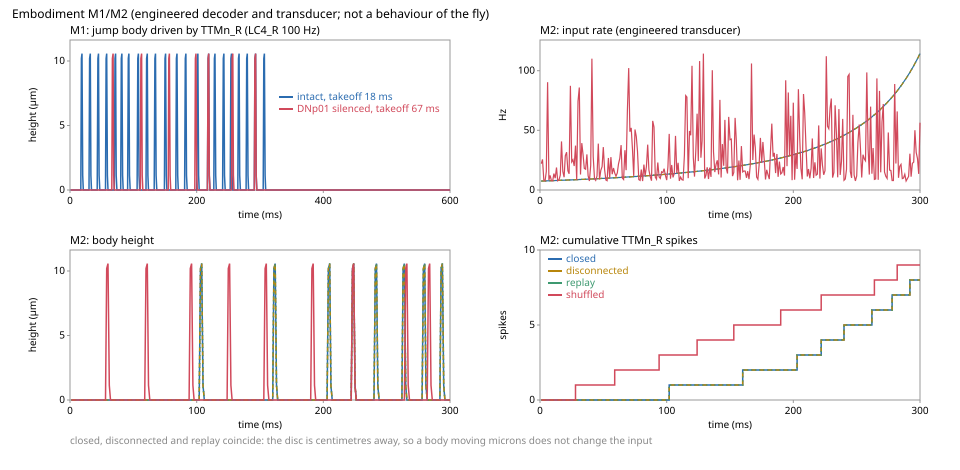

# Embodiment: M0 coupling ADR and v1 roadmap

Status: accepted for the synthetic M0 fixture. Implements [#32](https://github.com/gianlucamazza/flymsg/issues/32); informs architecture [#30](https://github.com/gianlucamazza/flymsg/issues/30) and experiment infrastructure [#27](https://github.com/gianlucamazza/flymsg/issues/27).

## Context and decision

The LIF simulator produces neural activity, not physical motor commands. Introduce a separate, standard-library-only `flymsg.embodiment` module with frozen, versioned data contracts and a structural `Body` protocol. Do not change `sim.Params`, neural integration or preregistered experiments. No physics runtime dependency is required.

M0 is an executable coupling fixture. It consumes an explicit stream of synthetic motor events and records synthetic sensor-to-neuron events. It does **not** feed those events back into the existing LIF loop. Online neural stepping, a real sensory encoder, gravity/contact, verified motor mapping and closed-loop experiments belong to later milestones.

## Contracts

| Contract       | Meaning                                                                                                                       |
| -------------- | ----------------------------------------------------------------------------------------------------------------------------- |
| `Provenance`   | Dataset name, SHA-256, source commit, seed, `flymsg.embodiment/v1`, `flymsg.clock/us-v1`                                      |
| `SpikeEvent`   | Dataset `bodyId` and integer microsecond timestamp; matrix row indices must be explicitly resolved by an adapter              |
| `Clock`        | Neural, body, control periods and command latency, in integer microseconds                                                    |
| `MotorCommand` | World +x force in newtons, timestamp and original source events                                                               |
| `BodyState`    | End-of-step timestamp, +x position in metres, velocity in metres/second                                                       |
| `SensorSample` | End-of-step timestamp, unique name, value in metres, `world/+x` frame                                                         |
| `Trace`        | Provenance, clock, decoder/encoder maps, control commands, every body state, every sensor sample and generated feedback event |

Fixture `bodyId`s are synthetic. A run on MaleCNS would take its motor neurons from [`validation/motor_map.yaml`](../validation/motor_map.yaml), where every row is `unmapped` today, so no real motor command can be issued. The force gain is newtons per event, held for one control interval. It is an engineered decoder, not a neuromuscular inference. The mock sensor encoder emits one event per body tick with positive position; this arbitrary fixture rule is not a biological sensory model. The seed is recorded but the fixture has no random sampling. The supplied dataset digest must match the expected digest; callers are responsible for hashing their actual dataset files.

## Clock and ordering

Default neural period is 100 microseconds (0.1 ms); body and control periods are 1000 microseconds. Require positive integer periods, body divisible by neural, control divisible by body, and latency on the neural grid. Unsupported ratios fail rather than silently round. Duration must be a positive multiple of the control period.

At control time `t`, consume all remaining events with `event.time_us + latency_us <= t`, retaining input order, including ties. Sum gains and hold that force over body steps until the next control boundary. A control interval with no newly eligible events commands zero force. This gives delivery time `ceil((event time + latency)/control period) * control period`. Additional quantisation delay is less than one control period; source timestamps are never changed. An event that cannot be delivered before run end fails preflight, so no trailing spikes are silently discarded.

Advance the body over `[t, t + body_us]` with semi-implicit Euler in the mock, then sample sensors at the end of the step. Generated sensory events carry that end timestamp; a future online neural adapter must define the subsequent input application phase explicitly. Initial mock position and velocity are zero. Zero force preserves an initially stationary body; it does not stop an already moving body.

## Failure and provenance policy

Validate the entire event stream, maps, digest and versions before any actuator call. Reject unordered/off-grid timestamps, unknown motor IDs, nonfinite gains and missing sensor mappings. After each body step, validate finite state and exact end timestamp, then require exactly the mapped sensors with valid units, frames and values. Any exception raised inside a body adapter call is re-raised as `ContractError`, with the original as its cause; the run stops and no further actuator call is made. A failed run must be discarded and the body reset; this contract cannot roll back a physical step already executed and is not a hardware safety controller.

`Trace.to_dict()` is JSON serializable. Store it as an artifact and include its hash and `asdict(trace.clock)` / mapping configuration in the existing `flymsg.run_manifest/v1` config or extra fields. Keep the existing manifest schema unchanged. The fixture is exploratory, not preregistered evidence; this metadata is intended to compose with #27, not implement that entire workbench.

## Executable example

```python
import json

from flymsg.embodiment import MockBody, Provenance, SpikeEvent, run_fixture

trace = run_fixture(
    (SpikeEvent(10, 0), SpikeEvent(10, 1000)),
    duration_us=4000,
    provenance=Provenance("synthetic", "a" * 64, "fixture", 7),
    expected_dataset_sha256="a" * 64,
    motor_map={10: 2.0},
    sensor_map={"position": 20},
    body=MockBody(),
)
print(json.dumps(trace.to_dict(), sort_keys=True))
```

## Acceptance and limits

`uv run pytest tests/test_embodiment.py` checks that the default neural tick is `sim.Params.dt`, repeatable round trips, analytical first-step units, exact event conservation/order, equal-time events, explicit latency, force holding, stationary baseline and fail-closed input/runtime handling. Existing CI discovers these tests automatically. Floating-point body integration is repeatable within one runtime; cross-platform bitwise physics equivalence is not promised. No connectome download is needed.

This fixture intentionally retains the complete trace in memory and scans the motor stream once. It is not a benchmark of full-CNS runtime or streaming storage. Backend-specific physical constraints and coordinate conversions must be introduced with their own contracts and acceptance tests.

## B6 v2: 6-DoF body and eye pose (G1, #178)

`flymsg.pose` (`flymsg.embodiment/v2`) is the type layer a 3D body and a projected eye will
share ([#178](https://github.com/gianlucamazza/flymsg/issues/178), gate G1 of the
[sensorimotor plan](sensorimotor-environment-plan.md)). It wires no body and passes no motor
command; M0 v1 above is frozen, and a v1 record never parses as v2 or the reverse.

- **Frames**, right-handed, SI units: `world` (FlyGym's, +z up), `body` (the `c_thorax` root:
  +x anterior, +y left, +z dorsal), `eye/L` and `eye/R` (FlyGym's eye cameras: optical axis
  −z, image up +y), `eyemap` (the Zhao et al. 2025 micro-CT head frame of `flymsg.eye`). A
  `Pose` maps child to parent coordinates and composes only through a shared frame.
- **Quaternions** are (w, x, y, z), MuJoCo's order, unit norm within 1e-9, stored with the
  first nonzero component positive and checked on construction, never rescaled, so a stored
  trace parses back bit for bit; degenerate, non-finite, reflected and non-orthonormal inputs
  refuse. FlyGym millimetres convert to metres in one function, `mm`.
- **State**: world ← body pose, linear velocity in world and angular velocity in body (the
  MuJoCo free-joint convention), integer microseconds.
- **Clock** (`embodiment.Clock`, unchanged): per body tick, sensors read the state at its start,
  the neural model advances, then physics steps under the command held since the last control
  tick; motor events aggregate at control ticks once their latency has passed, as in M0 v1.
  `state_at` returns the latest state not after the asked time, so no future pose reaches an
  earlier neural input.
- **Eye mounts** come from FlyGym 2.1.0 (`flygym_eye_mounts`): 0.23 mm anterior, ±0.38 mm
  lateral and 0.02 mm dorsal of the thorax origin, optical axes 63° off the midline and level;
  the right mount is the mirrored left one within 0.2°. FlyGym compiles with `fusestatic` on,
  which fuses the rigid head into its parent: in a simulation, with the fly on a free joint,
  both eye cameras land on the thorax origin (0.44 mm off, orientation kept); the mounts are
  read from a compile without it.
- **Registration** of `eyemap` into `body` has no default and needs a source: the rotation
  between the micro-CT head and NeuroMechFly's head is not measured
  ([#84](https://github.com/gianlucamazza/flymsg/issues/84),
  [#179](https://github.com/gianlucamazza/flymsg/issues/179)).
- **Actuators** are named by compiled MuJoCo name and id with a unit and the model they were
  compiled from; neurons stay MaleCNS bodyIds as in v1; `pose.command` refuses a
  name or id the compiled model does not have, then defers to `motor_map.command`, which refuses
  every row today.
- **Trace**: provenance, clock, both mounts and the states serialise to canonical JSON and
  parse back identically; another schema, clock or a missing field refuses.

`uv run pytest tests/test_pose.py` checks these. Wiring an actual body waits for an ADR update.

## Embodied v1 roadmap

Proposed 2026-10-12 (PRs #42 and #47); the target interfaces below are not implemented
classes. Three issue series describe this path: the M milestones of [#31](https://github.com/gianlucamazza/flymsg/issues/31), the E gates, and
the research workstreams. They overlap, so this table is the one map between them. The
research workstreams were filed as R1–R4, which collides with runtime R1–R2 ([#39](https://github.com/gianlucamazza/flymsg/issues/39), [#40](https://github.com/gianlucamazza/flymsg/issues/40));
here they are research A–D.

| Step                     | Issues                                                                                                                                                                                                                                             | Status                                                                                                                                                                        |
| ------------------------ | -------------------------------------------------------------------------------------------------------------------------------------------------------------------------------------------------------------------------------------------------- | ----------------------------------------------------------------------------------------------------------------------------------------------------------------------------- |
| Online neural stepping   | E1 [#43](https://github.com/gianlucamazza/flymsg/issues/43), runtime R0 ([runtime](runtime.md))                                                                                                                                                    | done in v0.8.21: `CpuRuntime` runs in blocks through checkpoint and restore and matches `sim.run` bit for bit, also on MaleCNS                                                |
| Looming stimulus and LC4 | E2 [#44](https://github.com/gianlucamazza/flymsg/issues/44), M2 [#34](https://github.com/gianlucamazza/flymsg/issues/34), research A [#49](https://github.com/gianlucamazza/flymsg/issues/49)                                                      | exploratory encoder and runtime bridge in v0.8.23 (below); no LC4 tuning data, no bodyId map                                                                                  |
| Closed loop on the body  | E3 [#45](https://github.com/gianlucamazza/flymsg/issues/45), E5 [#52](https://github.com/gianlucamazza/flymsg/issues/52), M1 [#33](https://github.com/gianlucamazza/flymsg/issues/33), M2 [#34](https://github.com/gianlucamazza/flymsg/issues/34) | M1 jump body (v0.8.34) and M2 closed loop with its controls (v0.8.35, below); engineered transducer and decoder; on MaleCNS at realistic scales the feedback changes no input |
| Motor map                | E4 [#46](https://github.com/gianlucamazza/flymsg/issues/46), research B [#50](https://github.com/gianlucamazza/flymsg/issues/50), M3 [#35](https://github.com/gianlucamazza/flymsg/issues/35)                                                      | blocked: `validation/motor_map.yaml` has no mapped row                                                                                                                        |
| Physical body            | E4 [#46](https://github.com/gianlucamazza/flymsg/issues/46), research C [#51](https://github.com/gianlucamazza/flymsg/issues/51), M3 [#35](https://github.com/gianlucamazza/flymsg/issues/35)                                                      | NeuroMechFly jump v1 ran and was short; FlyBody stays unselected ([#19](https://github.com/gianlucamazza/flymsg/issues/19)); the motor map stays unmapped                     |
| Falsification            | research D [#53](https://github.com/gianlucamazza/flymsg/issues/53), M4 [#36](https://github.com/gianlucamazza/flymsg/issues/36)                                                                                                                   | blocked on the steps above; existing calibration tasks are not held-out evidence                                                                                              |
| Observability            | E6 [#54](https://github.com/gianlucamazza/flymsg/issues/54), workbench [#27](https://github.com/gianlucamazza/flymsg/issues/27)                                                                                                                    | open; run manifests exist (`flymsg.run_manifest/v1`)                                                                                                                          |

### Objective

Connect an externally generated sensory stream to the MaleCNS LIF network, decode measured motor activity into a body action, and feed body state back into sensory input. Do not claim a biologically realistic animal until independent experimental checks pass.

### Invariants

1. Preserve the existing `sim` numerical reference and preregistered validation battery.
2. Every sensor-to-neuron and neuron-to-actuator mapping carries a citation, dataset version, units, confidence and explicit `unmapped` fallback.
3. No invented neuromuscular mapping is promoted from an engineering fixture to a biological claim.
4. Events have monotonic integer microsecond timestamps, stable ordering and deterministic seed provenance.
5. Separate open-loop, sham feedback, shuffled mappings, silencing and held-out tests.
6. Stop safely on invalid mappings, late events, nonfinite physical state or clock drift; never silently discard spikes.

### Interfaces

- `StimulusFrame(time_us, modality, payload, coordinate_frame, provenance)`
- `SensoryEncoder.encode(frame) -> tuple[SpikeEvent, ...]`
- `NeuralStepper.advance(until_us, incoming_spikes) -> tuple[SpikeEvent, ...]`
- `MotorDecoder.decode(spikes, interval_us) -> tuple[MotorCommand, ...]`
- `Body.step(commands, until_us) -> BodyState`
- `Sensor.read(body_state, until_us) -> tuple[StimulusFrame, ...]`

These are target interfaces, not implemented classes. The existing `flymsg.embodiment` v1 contracts should be reused or versioned, not silently broken.

### Delivery sequence

#### E1 — Neural online stepping

- Refactor LIF execution to pause/resume without changing spike ordering.
- Compare concatenated online steps with batch execution at identical seeds, bit-for-bit on the supported runtime.
- Add adversarial boundary, refractory, delay-ring and input-order tests.

#### E2 — Stimulus layer

- Implement a synthetic, deterministic looming angular-size/velocity waveform with documented geometry and sampling.
- Implement a separately validated LC4 encoder; do not label a generic rate heuristic as biologically measured.
- Compare against constant-rate Poisson baseline and a time-shuffled control.

#### E3 — Physical loop

- Reuse M0 clocks, provenance and fail-closed contracts.
- Use `MockBody` first; feedback must reach the actual neural stepper, not only a trace.
- Make mapping confidence and absence explicit; refuse unmapped MaleCNS motor actuation.

#### E4 — Biological actuator and body

- Map a specific motor pathway to a physical actuator only after sourcing muscle/kinematic evidence.
- Evaluate FlyBody/MuJoCo separately for physics, sex/morphology mismatch, licensing and Python environment isolation.
- Compare closed-loop behavior with independent experimental recordings, not the calibrated looming task alone.

### E2 exploratory looming encoder

Added in v0.8.23 (PR #47). Exploratory, not validated perception.

`flymsg.sensory.encode_looming` turns a circular object of radius `r`, approaching along the
viewing axis at constant speed `v` from distance `d0`, into timestamped drive samples on an
integer-microsecond grid. The distance is `d(t) = d0 - vt`, the angular size `2 atan(r/d)` and
the expansion rate its derivative, `2rv / (d² + r²)`. The rate is
`min(max_rate, baseline + gain × expansion)`. Gain and ceiling have no measured value, so the
caller states both; there is no default. A sample holds until the next one.

`flymsg.sensory_runtime.schedule_sensory_drive` draws seeded Poisson counts from those rates
and schedules them on a `CpuRuntime` at its current step boundary. The neural tick and the
number of input columns come from the runtime, so a rate cannot be scaled by the wrong step.

This is not a measured LC4 tuning curve, a retinal model or a sensor-to-bodyId map. The
`sim`, `validate` and `behavior` paths are unchanged, and the 29/29 calibration checks and the
failed held-out and silence checks are not evidence for this encoder. Before E2 can pass it
needs LC4/LPLC2 tuning data with uncertainty, a map from samples to MaleCNS sensory bodyIds,
and a comparison with the constant-rate Poisson drive and a time-shuffled control.

The eye, its column stimuli and the T4/T5 locks are in [eye](eye.md).

### A TTM-driven jump of NeuroMechFly (lock, 2026-10-13, #90, #94)

`flymsg.ttm` turns TTMn spikes into the measured muscle force: a twitch rising to 101 µN in
8.2 ms (Zumstein et al. 2004, wild-type females) after at most 0.85 ms (Allen & Murphey
2007), summed linearly. `flymsg.jump3d` replays those forces into FlyGym's NeuroMechFly
(v2.1.0, MuJoCo, a female body; now a flymsg dependency): every active leg joint is held at
the neutral pose by FlyGym's position actuators except the two mesothoracic coxa-trochanter
pitch hinges, which the TTMs drive with a torque equal to the twitch force times a moment
arm fixed at the stance posture (from the Jacobian at the distal active tarsal segment). The
body steps at 0.1 ms, the neural step, and the run is open loop.
[`validation/jump3d.yaml`](../validation/jump3d.yaml), locked before its run, drives LC4 on
both sides, records `TTMn_L` and `TTMn_R`, replays them, and compares the drag-free ballistic
range at takeoff with Zumstein et al.'s wingless jumps: 28.6 mm (measured, with air) to 37.75
mm (30.2 mm without the 20% of energy they attribute to air). Six compensations are named;
the TLM and the other legs do not push, so a short jump is the expected failure.

**Result of version 1 (2026-10-13): short.** Run from `c05878d`. The body leaves the ground
28–32 ms after the stimulus starts, at 0.044–0.059 m/s upward, and the drag-free range is
0.3–0.5 mm against 28.6–37.75 mm: about ten times too slow. Descriptive columns: before
takeoff only `TTMn_R` has fired (1–2 spikes; `TTMn_L` first fires about 14 ms later), so one
leg pushes and the body leaves sideways; one twitch of 101 µN is below the 137 µN per leg,
on both legs together, that Zumstein et al. compute a jump needs, and the femur-tibia
extensor is not modelled. The body bridge and the measured actuator work; the jump needs
both legs together and the TLM, which the model's motor side does not yet have. Outputs:
`results/jump3d/v1/`. Figure: [drag-free range](img/jump-range.svg).

**Closed loop (#90).** `jump3d.closed_loop` runs the connectome and the body together under
the M0 clock rules: integer periods, the body stepping at the neural step (0.1 ms), control
every 1 ms. Each block the incremental runtime (`CpuRuntime`, bit-identical to `sim.run`)
advances, the new TTMn spikes join the twitch trains from their own time on, and the body
integrates the same interval; at the first block boundary after takeoff the remaining
stimulus input is replaced by zeros, the behavior v1 one-bit loop with takeoff as the bit.
A test checks that the spikes before the cut equal an open-loop run with the same input and
that none follow the cut. No vision path (body pose → eye → photoreceptors) is built; T4/T5
v1–v3 found no direction selectivity through the eye ([eye](eye.md)).

### M1 jump body (v0.8.34, #33)

`flymsg.jump.JumpBody` is a point mass over a rigid floor: gravity, an actuator force along
+z, contact that stops the body without penetration or bounce, semi-implicit Euler at the M0
body step. It runs through `run_fixture`, so every M0 rule holds. The decoder is
`engineered_decoder`: each `TTMn_R` spike adds a force the caller states (`--gain-n`, newtons
per spike) for one control period. It is not a MaleCNS motor map, never goes through
`motor_map.command`, which stays fail-closed, and every output says so. Spikes too late to be
delivered before the run ends are counted, not dropped. Tests check rest without spikes, the
peak height `v²/2g` after one impulse, landing, a force below weight that does not lift, and
replay.

`flymsg jump --sim LC4_R --gain-n 2e-5 --mass-kg 1e-6` (seed 0, the battery protocol) gives
22 `TTMn_R` spikes and takeoff at 18.0 ms; with `--silence DNp01` it gives 7 spikes and
takeoff at 67.0 ms. Both jump about 10 µm with this arbitrary gain. The body inherits the
failed silence check of the one-bit protocol ([behavior](behavior.md)): silencing the giant
fiber does not stop the jump, and this is not a validated jump mechanism.

### M2 closed loop (v0.8.35, #34)

`flymsg.loop.run_loop` moves a disc of radius `r` toward the fly along −x; the fly's body
(`JumpBody`) moves along +z. At each 1 ms control boundary the angular size is computed from
the disc's position and the body's current height, its change over the next period becomes
a rate through an engineered transducer (gain in Hz per rad/s, capped; no LC4 value exists
for either), and seeded Poisson counts drive the stimulated neurons in `CpuRuntime` for that
period. The motor neuron's spikes in the period become a force (the M1 engineered decoder)
applied over the next one. A jump therefore changes the input that follows it. Unlike the
one-bit protocol, which only cuts the drive, the input here is recomputed from the body.

Three controls run with the same seed: `disconnected` computes the input with the body held
at z = 0, `shuffled` uses that rate series in a seeded random order, and `replay` feeds back
the closed loop's recorded input counts, which must reproduce its spikes exactly. Tests on a
synthetic chain with a body that rises centimetres check that the first input after takeoff
reads the new height, that the disconnected input ignores the body, that the replay
reproduces the spikes, that shuffling keeps the rates, and that a loop with the pose forced
to zero fails the first test.

On MaleCNS, `flymsg loop --sim LC4_R --radius-m 0.01 --distance-m 0.2 --speed-m-s 0.5
--transducer-gain 30 --max-rate-hz 200 --gain-n 2e-5 --mass-kg 1e-6` (300 ms, seed 0): the
body lifts at 103 ms after 8 `TTMn_R` spikes and rises about 10 µm. A disc that is still
centimetres away barely changes size when the body moves microns, so the closed and the
disconnected runs draw the same input at every step and give the same spikes. The replay
reproduces them; the shuffled input lifts the body at 29 ms. At these scales the loop is
closed in code and has no measurable effect on the model, and nothing here is a behaviour of
the fly.



### Muscles from MANC (Phase C)

`flymsg muscles` gives each MaleCNS `vnc_motor` neuron the target muscle and match certainty
that MANC published for its type: Cheong, Eichler, Stürner et al. 2024 (eLife 13:RP96084,
doi:10.7554/eLife.96084), Supplementary file 3 (see
[data](data.md#manc-muscles-flymsg-muscles)).
The join key is the MaleCNS `mancType` annotation, which equals `type` except for `ADNM1 MN`
and `ADNM2 MN` (MANC `ADNM1`, `ADNM2`). A target that names a body part (`abdomen`,
`hind leg`, `neck`, `wing`, `haltere` …) is kept as the target but not as a muscle.

| Status          | Neurons | Types | What MANC gives                                                                         |
| --------------- | ------: | ----: | --------------------------------------------------------------------------------------- |
| `muscle`        |     406 |    49 | one named muscle; a certainty (1–5) for 76; none for the 328 leg MNs and `ps2 MN`       |
| `region`        |     270 |    87 | a body part only: abdomen (`MNad`, 201), legs (`MNhl`, `MNml`, 45), neck 14 …           |
| `compound_type` |      17 |     3 | none: MaleCNS merged two MANC types (`MNad04,MNad48`, `MNad18,MNad27`, `MNnm07,MNnm12`) |
| `no_target`     |       6 |     3 | no target (`MNxm01`–`MNxm03`, "muscle target not characterized")                        |
| `untyped`       |       9 |     0 | the neuron has no type                                                                  |

The table lives in `data/motor/` and is regenerated from the pinned file; it is not part of
the motor map lock. `validation/motor_map.yaml` is unchanged: it maps body actuators, and no
source maps a muscle to a FlyBody or NeuroMechFly actuator, so every row stays `unmapped` and
`motor_map.command` still refuses (contract B6). MANC is a different male than MaleCNS, and
the muscle is a property of the type, not of the individual neuron.

MaleCNS also pairs each motor neuron with one MANC neuron (`mancBodyid`). For 623 neurons that
neuron is in Supplementary file 3; for 140 of them its type differs from the type-level
`mancType`: 33 only by name (same target), 107 with another target, mostly an antagonist or
accessory muscle of the same leg segment (`Ti flexor` against `Acc. ti flexor`, `Ta
depressor` against `Acc. ti flexor`). The rule (2026-10-13, #19): the muscle is the type's,
since `mancType` is curated per type and individual pairings in serially repeated leg types
can land on a neighbouring type; `muscles.parquet` records each neuron's `manc_neuron_type`
and `neuron_match_agrees` (empty when unresolvable), so the disagreements stay visible and
no per-neuron muscle is used.

### Evidence each step needs

From the research plan of PR #47. A step that lacks its evidence keeps the synthetic label.

- **Looming transduction.** What LC4 encodes (angular size, expansion, contrast,
  time-to-collision), over which stimulus regime, with what trial-to-trial variability; whether
  LC4 and LPLC2 are interchangeable. Record DOI, data accession, licence, fly sex, genotype,
  stimulus geometry and contrast, neural identity, recording modality and sampling, latency
  distribution, replicates, confidence intervals and whether raw trials are available. Hold
  out animals or trials before any fit. Anchors: von Reyn et al. 2014 (doi:10.1038/nn.3741),
  Ache et al. 2019 (doi:10.1016/j.cub.2019.01.079).
- **Motor map.** Which TTMn bodyIds innervate which jump muscles, bilaterally, with measured
  activation, force and timing. Record bodyId, cell type, muscle, laterality, source,
  anatomical evidence, confidence, units, morphology sex and the FlyBody actuator with its
  commit. Without evidence a row stays `unmapped` and the command fails.
- **Physical body.** Pin FlyBody and MuJoCo, isolate them from the Python 3.13 runtime,
  record the morphology and sex mismatch, and validate timebase, units, contacts and
  integration stability before comparing kinematics with independent recordings. A walking
  policy is not a connectome motor decoder.
- **Falsification.** Freeze protocols and seeds before running: real against shuffled
  connectome, looming against matched non-looming controls, intact against bilateral DNp01
  silencing, feedback against matched open loop, and sensitivity over parameters, seeds and
  datasets. Report effect sizes, intervals, failure thresholds and every negative result.

### Acceptance gates

- E1: batch/stream parity on synthetic and MaleCNS fixtures; no regressions.
- E2: replayable timestamped stimuli, calibrated response and negative controls.
- E3: closed-loop causal feedback test that fails when feedback is disconnected.
- E4: measured motor map and held-out behavioral performance, with failures reported.
- Performance: publish real-time factor, memory and latency distribution; do not claim real-time until measured.

### Existing evidence and blockers

- M0 records synthetic sensory events. M2 and `jump3d.closed_loop` feed a stated stimulus
  back into `CpuRuntime`. The path from body pose through the eye is not built: T4/T5 v1–v3
  found no direction selectivity through the eye (robust neither, [eye](eye.md)).
- `validation/motor_map.yaml`: every real actuator is `unmapped`. 406 of 708 motor neurons
  have a MANC muscle (`flymsg muscles`), but no source maps a muscle to an actuator.
  NeuroMechFly jump v1 ran and was short. FlyBody stays unselected.
- [behavior](behavior.md): the one-bit looming loop cuts the drive and fails the DNp01
  silence check.
- [benchmarks](benchmarks.md): held-out olfactory specificity and stability fail.
- [model](model.md): the default model does not gain a mechanism in order to pass a check.
  Optional gap junctions, graded release and one plasticity rule stay off unless a lock
  names them.
