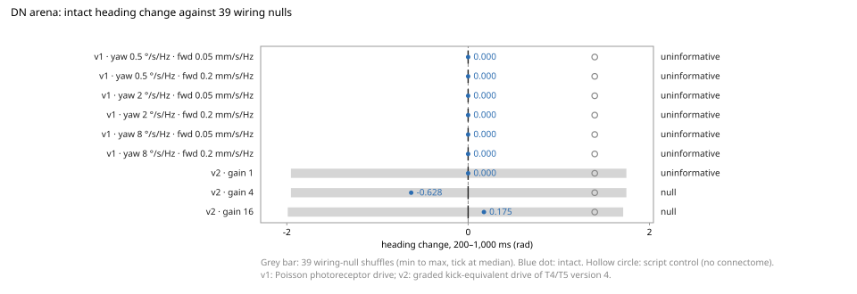

# DN arena

The synthetic steering fixture of the [DN-arena ADR](../adr/adr-dn-arena.md): the full
MaleCNS v1.0 connectome in a closed loop with the kinematic planar body `flymsg.arena`,
an engineered descending-neuron readout (`flymsg.dn_decoder`) and a lateral dark
sphere. Version 1 drives the photoreceptors with Poisson rates; version 2 drives the
graded visual pathway of T4/T5 version 4. Lock:
[`validation/dn_arena.yaml`](https://github.com/gianlucamazza/flymsg/blob/main/validation/dn_arena.yaml)
(issue #263). Neuron identities: [DN inventory](../dn-arena-inventory.md).

## Version 2 result: depends

**Envelope verdict: `depends`.** The three configurations do not share a verdict. At
lamina-to-medulla gain 1 the six decoder neurons fire no spike in the intact arm, so
the lock's no-go makes it `uninformative`. At gains 4 and 16 the readout fires, and the
intact heading change lies inside the range of the 39 wiring-null shuffles: `null`.
No configuration gives a `difference`.

| Gain | Intact (rad) | Disconnected | Shuffled | Replay | Silenced | Wiring null min, median, max | Intact decoder spikes             | Verdict       |
| ---: | -----------: | -----------: | -------: | -----: | -------: | ---------------------------- | --------------------------------- | ------------- |
|    1 |            0 |            0 |        0 |      0 |        0 | −1.955, 0, 1.745             | none                              | uninformative |
|    4 |       −0.628 |       −0.663 |   −0.663 | −0.628 |        0 | −1.955, 0, 1.745             | DNa02 R 20, DNa02 L 3             | null          |
|   16 |        0.175 |        0.244 |    0.244 |  0.175 |        0 | −1.990, 0, 1.710             | DNa02 L 22, DNa02 R 21, DNa01 L 1 | null          |

Heading change is the unwrapped heading from 200 to 1,000 ms; positive turns left,
toward the sphere. The script control turns 1.396 rad toward the darker eye in every
configuration (intact minus script: −1.396, −2.025, −1.222 rad). Replay parity holds in
all three. oDN1 never fires, so the forward command is 0 in every intact arm.

What the numbers say, within the lock:

- The intact readout is small: 23 and 44 decoder spikes in one second, against up to
  71 in single shuffles. The intact turn has opposite signs at gains 4 and 16.
- Disconnected and intact differ by at most 0.07 rad. The body's feedback changes the
  readout by a few spikes, so the turn comes from the drive, not from the loop.
- Shuffled equals disconnected, as in version 1. It is reported and outside the
  verdict.

Archived tables:
`results/dn-arena/v2.executions/edd21a61…/output/` (`results.csv`, `verdict.json`,
`manifest.json`). The 133 closed-loop records (3.5 GB gzipped JSON) stay in the run
directory; `results.csv` carries the sha256 of each record's canonical JSON, and the run
is deterministic. The run was made from clean `main` at `ec3d080`, with 4 workers, in
5 h 23 min of wall time under load. As the lock's data rule requires, it is archived as
it is and will not be rerun with new configurations, gains, geometry or seeds.

### Where the null range comes from (exploratory, after the verdict)

This reading uses only the archived `results.csv`. It does not change the verdict.

In each configuration, 30 or 31 of the 39 shuffles give a heading change of 0, and the
range's ends come from the same six seeds in all three configurations (7308, 7316,
7317, 7323, 7327, 7333). In each of them a single decoder neuron fires 24 to 71 spikes,
almost the same count at gains 1, 4 and 16. That activity belongs to the shuffled graph
and barely depends on the visual gain. The test asks whether the intact turn falls
outside that band, and the intact readout is weaker than the band's ends. With one
stimulus, one decoder cell and 39 nulls, this fixture cannot separate a small
connectome-dependent turn from the shuffled graphs' own activity.

## Version 1 result: uninformative

**Envelope verdict: `uninformative`.** At every cell of the gain envelope (yaw gain
0.5, 2 and 8 °/s per Hz × forward gain 0.05 and 0.2 mm/s per Hz), the six decoder
neurons (DNa01 L/R, DNa02 L/R, oDN1 = `DNg97` L/R) fired no spike in the intact arm.
The lock's no-go therefore applies: with a silent readout, the decoder sends no
command, and the comparison with the 39 wiring-null shuffles is empty.

| Arm or control                                        | Heading change, 200–1,000 ms (rad) | Decoder spikes |
| ----------------------------------------------------- | ---------------------------------: | -------------: |
| intact                                                |                                  0 |              0 |
| disconnected                                          |                                  0 |              0 |
| shuffled (equal to disconnected, outside the verdict) |                                  0 |              0 |
| replay (parity passed)                                |                                  0 |              0 |
| silenced                                              |                                  0 |              0 |
| wiring null, 39 seeds per cell (min, median, max)     |                            0, 0, 0 |              0 |
| script (no connectome)                                |                              1.396 |              — |

Every cell gives the same numbers. The script control turns toward the darker eye at
100 °/s from 200 ms on: 0.8 s × 100 °/s = 80° = 1.396 rad. It shows that the body, the
stimulus geometry and the score respond as locked. Replay parity holds in all six cells.

Archived tables:
`results/dn-arena/v1.executions/df21c26c…/output/` (`results.csv`, `verdict.json`,
`manifest.json`). The 265 full closed-loop records (2.2 GB gzipped JSON) stay in the
run directory. `results.csv` carries the sha256 of each record's canonical JSON, and
the run is deterministic, so a rerun of the same commit reproduces them. The run was
made from clean `main` at `1043368`, with 4 workers, in 1 h 48 min of wall time under
load. As the lock's data rule requires, it is archived as it is and will not be rerun
with new gains, geometry or seeds.

## Why the readout is silent (exploratory, after the verdict)

This section was written after the verdict. It does not change it and is not scored.
One open-loop second at full light drove every input photoreceptor at 100 Hz, the
upper bound, since the sphere only lowers rates. The run used Poisson seed 7000 and
the lock's 22-step dead time
(`scripts/dn_arena_v1_exploratory.py`).

| Class                | Neurons | Active |  Spikes |
| -------------------- | ------: | -----: | ------: |
| Input photoreceptors |   3,903 |  3,903 | 321,261 |
| Lamina L1–L5         |   8,883 |      0 |       0 |
| Mi / Tm / TmY        |  37,631 |      0 |       0 |
| T4 / T5              |  13,585 |      0 |       0 |
| LC / LPLC            |   4,674 |      0 |       0 |
| DN\* types           |   1,342 |      0 |       0 |
| Whole brain          | 165,122 |  3,903 | 321,261 |

Only the photoreceptors fire. All 64,171 of their output synapses in the model are
inhibitory: their transmitter is histamine, and the model gives histamine a negative
sign. In a LIF network with no other drive and no tonic activity, inhibition alone
never brings a neuron to threshold. The silence is therefore structural. It holds for
any photoreceptor rate, any gain and any stimulus geometry. The decoder neurons are
only 2–3 synapses from the inputs, so the distance is not the cause.

This is the blocker T4/T5 version 1 had already shown: contrast stopped at the
lamina ([eye](../reference/eye.md)). The DN-arena ADR kept the Poisson drive for version 1
(Decision 3), and the lock's no-go turned the outcome into an explicit
`uninformative` rather than a false null. With hindsight, the T4/T5 version 1 result
already predicted this outcome before the lock. The lock cites that version only for
its 100 Hz rate (`transducer.rate_from`), not as a prediction of a silent readout.

## Version 2 lock

`validation/dn_arena.yaml` version 2 is the graded-input lock (`vee1-4`), approved by
the owner and merged on 2026-10-20 (#284), lock hash `1426386c…`. It keeps the MaleCNS
graph, the kinematic body, the lateral dark sphere and the six decoder neurons. The
drive is the kick-equivalent of T4/T5 version 4, `float32(gain * (1 - coverage))`, over
three configurations: lamina-to-medulla gains 1, 4 and 16 at that version's midpoints
and 200 Hz release, the configurations where T4 fires most
([T4 spikes per configuration](../img/t4-spikes.svg)). One decoder cell uses 2 °/s per
Hz of yaw and 0.2 mm/s per Hz of forward. Each graph is dark-anchored before its loop; a
wiring null (seeds 7300–7338) keeps the intact photoreceptor release rate and drive gain
and anchors on its own shuffled graph. A timing-only smoke (no spike, command or heading
read) estimated about 3 h for the run with 4 workers; under load it took 5 h 23 min.

## What follows

- No further version of this lock is planned. A different stimulus, decoder or null
  count would be a new lock with its own approval, not a rerun of version 2.
- Steering by the connectome needs a readout that the shuffled graphs do not match.
  This fixture's six neurons and one second do not give one. A body that is not
  kinematic needs the motor and proprioceptive interfaces proposed in #288.
- Nothing here is a claim about steering, the descending neurons or flight. The
  components keep the statuses of the ADR's evidence table; `validation/evidence.yaml`
  is unchanged.
